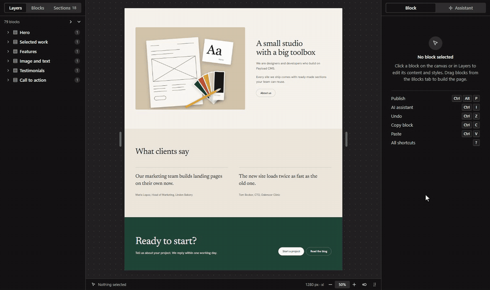
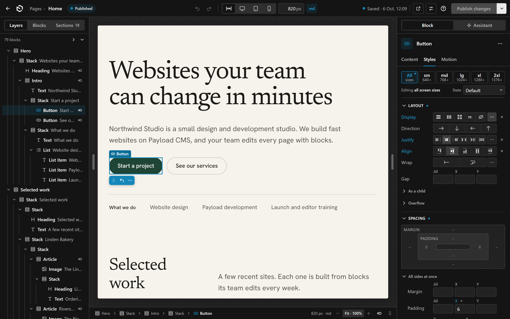
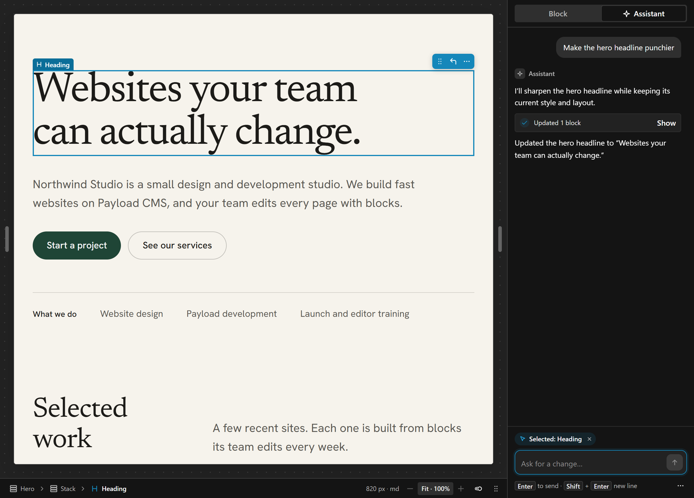
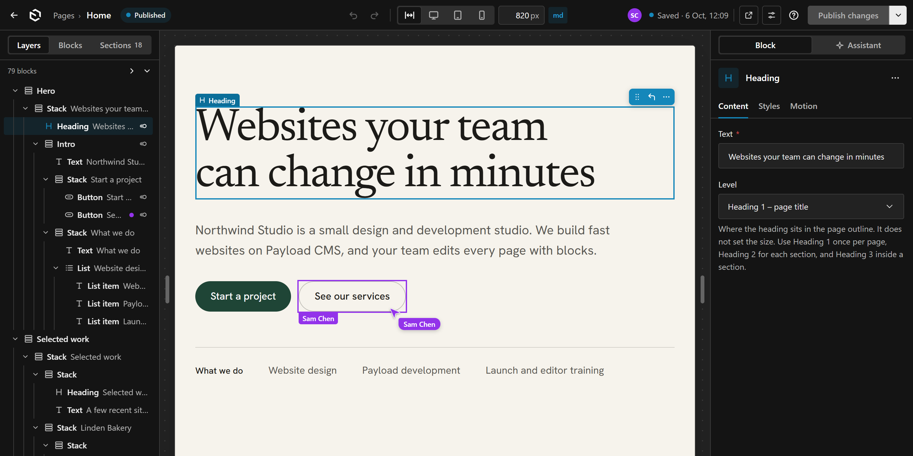
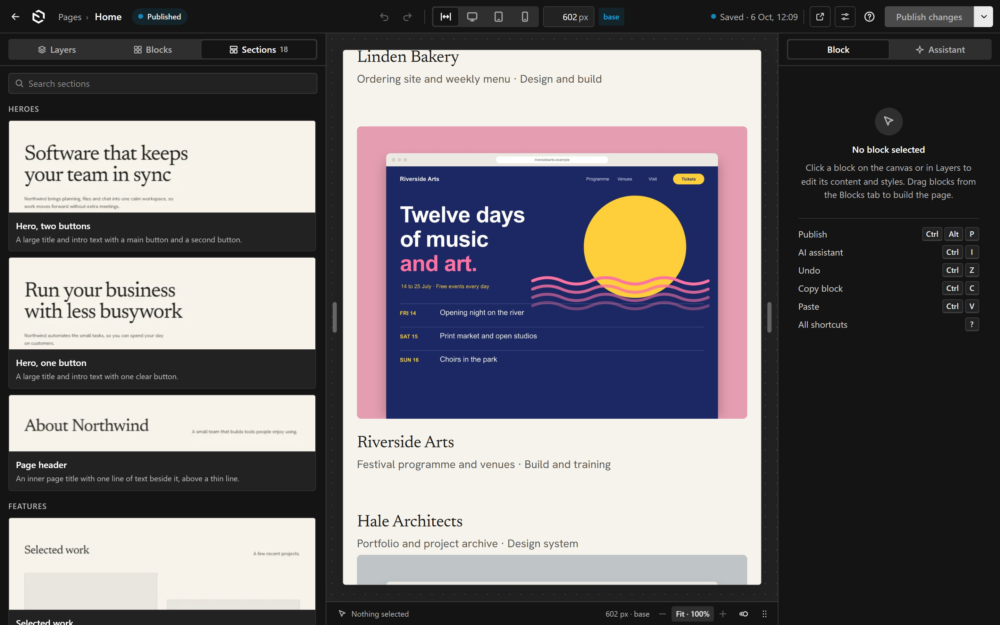

# Payload Canvas

<p align="center">
  <a href="https://github.com/jon8800/payload-canvas/blob/main/docs/media/drag-and-drop.mp4"></a>
</p>

<table>
  <tr>
    <td width="50%"><br><sub>The full-screen builder: Layers, the live canvas, and the Styles panel.</sub></td>
    <td width="50%"><br><sub>The AI assistant edits the page from a prompt.</sub></td>
  </tr>
  <tr>
    <td><br><sub>Multiplayer: another editor's cursor and selection show live.</sub></td>
    <td><br><sub>Ready-made sections with real thumbnails.</sub></td>
  </tr>
</table>

A visual page builder for Payload CMS 3. It adds a full-screen builder to the collections you choose. Editors drag blocks onto a live canvas, nest them without limit, and style them with Tailwind classes. AI agents can build and edit the same pages over MCP, and an open editor shows each AI change as it happens.

The npm package is `payload-canvas`.

- Works in any Payload 3.90+ app on Next.js 16 and React 19.
- The layout is one JSON field per document. Nothing changes in your other fields.
- The site renders the layout with `payload-canvas/react` (React Server Components), or with your own renderer.
- Save, drafts, autosave, versions and access control stay Payload's own.
- Several people (and AI agents) can edit one page at the same time. See [Multiplayer editing](#multiplayer-editing).

One package holds everything: the Payload plugin and admin editor (`payload-canvas`), and the React renderer and canvas runtime for your site (`payload-canvas/react`). See [Entry points](#entry-points).

**Quick start.** Add the builder to an existing Payload app with the [install guide](#install) (about ten minutes). Or create a new project from the starter app:

```bash
npx create-payload-canvas my-website
```

## Contents

1. [Requirements](#requirements)
2. [Install](#install)
3. [The builder view](#the-builder-view)
4. [Inline editing](#inline-editing)
5. [Plugin options](#plugin-options)
6. [Rendering the layout on your site](#rendering-the-layout-on-your-site)
   - [Custom components](#custom-components)
7. [Server components in the canvas](#server-components-in-the-canvas)
   - [Whole-page editing: regions outside the layout](#whole-page-editing-regions-outside-the-layout)
8. [Custom blocks](#custom-blocks)
   - [Validation, hooks and access on block fields](#validation-hooks-and-access-on-block-fields)
   - [Built-in blocks](#built-in-blocks)
9. [Using existing Payload blocks](#using-existing-payload-blocks)
10. [Sections](#sections)
11. [Styling](#styling)
   - [Editable classes](#editable-classes)
12. [Animations](#animations)
13. [Theme](#theme)
14. [Templates and binding](#templates-and-binding)
15. [References and Used in](#references-and-used-in)
16. [Localization](#localization)
17. [AI assistant](#ai-assistant)
18. [AI editing over MCP](#ai-editing-over-mcp)
19. [Multiplayer editing](#multiplayer-editing)
20. [Production and Docker](#production-and-docker)
21. [Deploying](#deploying)
22. [Troubleshooting](#troubleshooting)
23. [Limits](#limits)

## Requirements

- `payload`, `@payloadcms/ui`, `@payloadcms/richtext-lexical` 3.90 or later (Payload 3 only, not the Payload 4 canary)
- `next` 16.3 or later, `react` and `react-dom` 19.2 or later
- `tailwindcss` 4.3 or later (the plugin compiles your Tailwind entry CSS)
- Node.js 20.9 or later
- Any Payload database adapter. Postgres and SQLite store the layout as `jsonb`/JSON.

You do not need `transpilePackages` or a `sass` install. The package ships compiled JavaScript. The admin styles are `.scss` files, and Next compiles them with the `sass` that `@payloadcms/next` already installs, the same way it compiles Payload's own admin styles.

Peer dependencies:

| Package | Range | Needed for |
|---|---|---|
| `payload`, `@payloadcms/ui`, `@payloadcms/richtext-lexical` | `^3.90.0` | everything |
| `next` | `^16.3.0` | everything |
| `react`, `react-dom` | `^19.2.0` | everything |
| `tailwindcss` | `^4.3.0` | the CSS compile on save and in the canvas |
| `@anthropic-ai/sdk` | `>=0.131.0`, optional | only the `/ai/anthropic` adapter |
| `payload-mcp-toolkit` | `>=0.9.0`, optional | only `builderMcpTools()` (`/mcp`) |
| `zod` | `^3.25 \|\| ^4`, optional | only `builderMcpTools()` (`/mcp`) |

## Install

These steps start from a blank Payload app with Postgres:

```bash
npx create-payload-app@latest -n my-site -t blank --db postgres --use-pnpm
```

They were tested step by step on such an app with Payload 3.90.2, Next.js 16.3.3, React 19.2.6, Tailwind 4.3.3, TypeScript 5.7 and pnpm 10, in `next dev` and in `next build` + `next start`. An existing Payload app works the same way: skip what you already have.

### 1. Add the package

```bash
pnpm add payload-canvas tailwindcss @tailwindcss/postcss postcss
```

With npm: `npm install payload-canvas tailwindcss @tailwindcss/postcss postcss`.

### 2. Add a collection with pages

Any collection works. This one uses drafts, so the editor gets **Save Draft** and **Publish**.

```ts
// src/collections/Pages.ts
import type { CollectionConfig } from 'payload'

export const Pages: CollectionConfig = {
  slug: 'pages',
  admin: { useAsTitle: 'title' },
  access: {
    // Signed-in users see drafts. Visitors see published pages only.
    read: ({ req }) => (req.user ? true : { _status: { equals: 'published' } }),
  },
  versions: { drafts: true },
  fields: [
    { name: 'title', type: 'text', required: true },
    { name: 'slug', type: 'text', required: true, unique: true, index: true },
  ],
}
```

### 3. Make one block list

The plugin, the site and the canvas must use the same block list. Put it in its own file. Import blocks from `payload-canvas/blocks`: that entry has no server code, so client components can import it too.

```ts
// src/builder.ts
import { defaultBlocks } from 'payload-canvas/blocks'

export const blocks = defaultBlocks({ mediaCollection: 'media', linkCollections: ['pages'] })
```

### 4. Add the Tailwind entry CSS

This file is your site's CSS. The plugin also compiles each page's classes from it. The variables on `:root` are defaults: the plugin's **Theme** global overrides them, so editors can change the colors, fonts and radius in the admin. See [Theme](#theme).

```css
/* src/app/(frontend)/globals.css */
@import "tailwindcss";

/* Defaults. The Theme global (admin > Theme) overrides them. */
:root {
  --background: oklch(1 0 0);
  --foreground: oklch(0.145 0 0);
  --primary: oklch(0.55 0.2 260);
  --primary-foreground: oklch(0.985 0 0);
  --secondary: oklch(0.97 0 0);
  --secondary-foreground: oklch(0.205 0 0);
  --muted: oklch(0.97 0 0);
  --muted-foreground: oklch(0.556 0 0);
  --accent: oklch(0.97 0 0);
  --accent-foreground: oklch(0.205 0 0);
  --border: oklch(0.922 0 0);
  --radius: 0.625rem;
}

@theme {
  --font-sans: ui-sans-serif, system-ui, sans-serif; /* the theme's body font replaces it */
  --font-heading: var(--font-sans);                   /* `font-heading`; the theme's heading font replaces it */
}

@theme inline {
  --color-background: var(--background);
  --color-foreground: var(--foreground);
  --color-primary: var(--primary);
  --color-primary-foreground: var(--primary-foreground);
  --color-secondary: var(--secondary);
  --color-secondary-foreground: var(--secondary-foreground);
  --color-muted: var(--muted);
  --color-muted-foreground: var(--muted-foreground);
  --color-accent: var(--accent);
  --color-accent-foreground: var(--accent-foreground);
  --color-border: var(--border);
  --radius-sm: calc(var(--radius) - 4px);
  --radius-md: calc(var(--radius) - 2px);
  --radius-lg: var(--radius);
  --radius-xl: calc(var(--radius) + 4px);
}
```

```js
// postcss.config.mjs
export default {
  plugins: { '@tailwindcss/postcss': {} },
}
```

The site layout imports this file in [step 7](#7-render-pages-on-the-site). The blank template has `src/app/(frontend)/styles.css` with a dark style for its welcome page, and its rules fight Tailwind's. Delete the file and the `import './styles.css'` line in `src/app/(frontend)/page.tsx`. Step 7 replaces the layout that imports it too.

### 5. Add the plugin

```ts
// src/payload.config.ts
import { websiteBuilder } from 'payload-canvas'
import { blocks } from './builder'
import { Pages } from './collections/Pages'

export default buildConfig({
  collections: [Users, Media, Pages],
  // ...
  plugins: [
    // other plugins first
    websiteBuilder({
      collections: { pages: { url: (doc) => `/${doc.slug}` } },
      blocks,
      css: { entry: 'src/app/(frontend)/globals.css' },
    }),
  ],
})
```

Keep `websiteBuilder` **last** in `plugins`. See [Troubleshooting](#troubleshooting).

Then regenerate the import map and the types:

```bash
pnpm payload generate:importmap
pnpm payload generate:types
```

### 6. Add the canvas route

The editor shows the page in an iframe. The iframe loads a route in your app, so the canvas uses your real block components and your CSS. Give the route its own root layout, without your site header and footer, and import your site's CSS in it.

```tsx
// src/app/(builder-canvas)/layout.tsx
import { ThemeStyle } from 'payload-canvas/react/server'
import config from '@payload-config'
import { getPayload } from 'payload'
import type { ReactNode } from 'react'

// Your site's CSS: it holds every class Tailwind found in your files.
import '../(frontend)/globals.css'

export default async function CanvasLayout({ children }: { children: ReactNode }) {
  const payload = await getPayload({ config })
  return (
    <html lang="en">
      {/* The same body classes as your site layout. */}
      <body className="font-sans antialiased">
        {/* The Theme global's variables and fonts (React moves them into the head). `live` reloads
            them after a theme save. Not in a <head> element: `live` adds a client component, and
            Next's metadata then fails to hydrate on some loads. */}
        <ThemeStyle payload={payload} live />
        {children}
      </body>
    </html>
  )
}
```

The page is a server component that imports the server action, and passes it to a small client component that renders `BuilderCanvas`:

```tsx
// src/app/(builder-canvas)/builder-canvas/page.tsx (a server component: no 'use client')
import { builderCanvas } from './actions'
import { CanvasClient } from './CanvasClient'

export default function CanvasPage() {
  return <CanvasClient server={builderCanvas} />
}
```

```tsx
// src/app/(builder-canvas)/builder-canvas/CanvasClient.tsx
'use client'

import { BuilderCanvas, type BuilderCanvasProps } from 'payload-canvas/react/canvas'
import { blocks } from '@/builder'

export function CanvasClient({ server }: { server: BuilderCanvasProps['server'] }) {
  return <BuilderCanvas blocks={blocks} server={server} />
}
```

Keep the page a server component. The server action returns React Server Component output that holds client components: yours inside server-rendered blocks (an image, a carousel), and the builder's own (slot outlets, the page frame's layout). Next registers them in the route's client manifest only when a server component of the route imports the action. When a `'use client'` page imports it, they are missing, and the canvas shows "Could not find the module … in the React Client Manifest". Client-only props (`plugins`, `components`, `resolveLink`) belong in `CanvasClient`.

```ts
// src/app/(builder-canvas)/builder-canvas/actions.ts
'use server'

import config from '@payload-config'
import { createCanvasServer, type CanvasServerRequest } from 'payload-canvas/react/server'
import { blocks } from '@/builder'

const canvas = createCanvasServer({ config, blocks })

export async function builderCanvas(request: CanvasServerRequest) {
  return canvas(request)
}
```

The server action renders the blocks the canvas cannot render itself: server components that load data. It is optional. Without it, those blocks show "Name: no preview in the editor". See [Server components in the canvas](#server-components-in-the-canvas).

How the canvas gets its CSS, in this order:

1. **Your site's CSS.** Tailwind puts every class it finds in your files into it, so your components' own classes work on the canvas as on the site. Blocks do not have to list them in `classes`.
2. **The theme** (`ThemeStyle`). Its `:root:root` rule wins over the `:root` defaults in your CSS.
3. **The CSS for the classes in the layout** and in each block's `classes`. The canvas compiles it in the browser (about 4 ms per new class) from the same entry file as the save hook, and puts it after your CSS. On the site, the generated CSS also comes after your CSS, so the canvas shows the same result. This CSS also holds Preflight and your base styles a second time. Both copies come from the same entry file, so they are identical and change nothing.

The generated CSS styles only block elements, so it never changes the order of your own classes. Every rule in it matches only elements with the class `builder-css`, and `RenderLayout` adds that class to the `className` of every block with classes. Example: a header layout uses `flex`, and your component has `flex md:grid`. Your component's element has no `builder-css`, so the generated `flex` does not reach it, and your site's CSS makes it `grid` from `md` up. A block's element has all its classes in the generated CSS, which is in Tailwind's order and comes last. The rules use `:where(.builder-css)`, which adds no specificity.

Earlier versions told you to leave your site's CSS out of the canvas, because the canvas compiles the full CSS for the layout's classes itself. That missed the classes your components use themselves. If you skip the import, the canvas still works, but only the classes in the layout and in each block's `classes` have CSS.

The same page also renders the library's section thumbnails: the editor loads it hidden, with `?mode=thumbnail`, when the **Sections** tab needs pictures. Nothing to add for that. A thumbnail copies the page's stylesheets into the picture, and it waits for server blocks before it takes the picture.

The default path is `/builder-canvas`. Change it with the `canvasPath` option. If your app has a single root `app/layout.tsx`, move the site into a route group first, so the canvas can have its own root layout. Payload's templates already use `(frontend)` and `(payload)` groups.

### 7. Render pages on the site

The site layout imports your CSS and renders the Theme global's variables and fonts in the `<head>`. Replace the blank template's layout with this one:

```tsx
// src/app/(frontend)/layout.tsx
import { ThemeStyle } from 'payload-canvas/react/server'
import config from '@payload-config'
import { getPayload } from 'payload'
import type { ReactNode } from 'react'

import './globals.css'

export default async function RootLayout({ children }: { children: ReactNode }) {
  const payload = await getPayload({ config })
  return (
    <html lang="en">
      <head>
        <ThemeStyle payload={payload} />
      </head>
      <body className="font-sans antialiased">{children}</body>
    </html>
  )
}
```

The page route loads a page by its slug and renders its layout:

```tsx
// src/app/(frontend)/[slug]/page.tsx
import type { GeneratedCss } from 'payload-canvas'
import { normalizeLayout } from 'payload-canvas/core'
import { RenderLayout } from 'payload-canvas/react'
import { loadLayoutData } from 'payload-canvas/react/server'
import config from '@payload-config'
import { draftMode } from 'next/headers'
import { notFound } from 'next/navigation'
import { getPayload } from 'payload'

import { blocks } from '@/builder'

type Props = { params: Promise<{ slug: string }> }

export default async function Page({ params }: Props) {
  const { slug } = await params
  const { isEnabled: draft } = await draftMode()
  const payload = await getPayload({ config })
  const { docs } = await payload.find({ collection: 'pages', where: { slug: { equals: slug } }, limit: 1, draft })
  const page = docs[0]
  if (!page) notFound()

  const layout = await loadLayoutData(normalizeLayout(page.layout), blocks, payload, { draft })
  return <RenderLayout layout={layout} blocks={blocks} css={(page.layoutCss as GeneratedCss | null)?.css} />
}
```

`page.layout` and `page.layoutCss` exist in `payload-types.ts` after `generate:types` (step 5). The `draft` flag shows drafts only in Next's draft mode, so the site shows the published version.

### 8. Add the standalone tracing lines

Skip this step if you do not use `output: 'standalone'`. On every save, the plugin compiles Tailwind classes. The compile reads your CSS entry and Tailwind's CSS files from disk, so Next's file tracer cannot see them. List them in `next.config.ts`:

```ts
const nextConfig: NextConfig = {
  output: 'standalone',
  outputFileTracingIncludes: {
    '/*': [
      './src/app/\\(frontend\\)/globals.css',
      './node_modules/tailwindcss/package.json',
      './node_modules/tailwindcss/*.css',
      // Add every package your CSS entry imports, e.g. './node_modules/tw-animate-css/dist/*.css'
    ],
  },
}
```

Escape `(` and `)` in route group names: the paths are globs.

### 9. Turn off Next's compression

In `next.config.ts`, set `compress: false` and let your reverse proxy compress responses (see [Deploying](#deploying)). Next's built-in gzip adds one listener to the gzip stream for each backpressure event while it streams a large HTML page. The admin and builder pages are large. In production this logs `MaxListenersExceededWarning: 11 drain listeners added to [Gzip]` many times. The listeners are freed when the response ends, so this is only noise, but it hides real warnings.

```ts
const nextConfig: NextConfig = {
  compress: false,
}
```

### 10. Run it

```bash
pnpm dev
```

1. Open `http://localhost:3000/admin` and create the first user.
2. Create a page with a title and a slug, for example `about`.
3. Click the **Builder** tab (or **Open builder** on the layout field). The builder opens full screen. Click or drag blocks from the **Blocks** tab. Double-click text on the canvas to edit it in place, or edit it in the right panel. Style the selected block in **Styles**.
4. Click **Publish changes** in the top bar and open `http://localhost:3000/about`.

In development, Payload's Postgres adapter pushes the new tables and columns on `pnpm dev`. Before your first production deploy, create a migration and commit it:

```bash
pnpm payload migrate:create
```

Run it in production with `pnpm payload migrate`, or with `prodMigrations` in `postgresAdapter`. Never run `payload migrate` on a development database that uses push. See [Production and Docker](#production-and-docker).

## The builder view

The builder is a full-screen admin view at `/admin/builder/<collection>/<id>`. It has no Payload nav and no document header: one top bar holds everything.

How editors open it:

- the document's **Builder** tab (a link to the view),
- the **Open builder** button on the layout field in the normal Edit view (a new document must be saved first),
- the old tab URL `/admin/collections/<collection>/<id>/builder`, which redirects to the view.

The top bar, left to right:

- **Back** to the document's Edit view, the admin icon (to the dashboard), and `Collection › Title`. Click the title to rename the document: Enter or leaving the field saves it (as a draft when the collection has drafts). Escape cancels.
- The status: **Draft** (never published), **Published**, or **Changed** (published, with newer draft changes). Hover it for the last change, the creation date, the last publish and the number of versions (opens the Versions drawer).
- Undo and redo, the canvas width and the active breakpoint. **Fluid** (the default) fills the space between the sidebars, so the breakpoint follows the free width. Desktop (1280 px), tablet, mobile and a custom width are fixed widths. In a template: the sample document the canvas previews.
- The people on the page, and the save state: **Saving…** while changes are on their way, then **Saved · 12:04**.
- **Preview** opens the draft preview (the collection's `admin.livePreview.url`, else `admin.preview`), or the public page (the plugin's `url` option), in a new tab.
- **Page settings** opens the document's own edit form in a Payload drawer: title, slug, SEO, and for a template its collection and sample document. The top bar updates after each save.
- The AI assistant (with the `ai` option), the keyboard shortcuts, and **Publish changes**. Its menu has **Unpublish**, **Revert to published** (drops all draft changes, after a confirmation), **Versions** and **API** (Payload's own screens, in a drawer over the builder), and links to the Edit view and the live page. In the Versions drawer, open a version to compare it, then **Restore as draft**: every open editor gets the restored layout, and the site keeps the published version until you publish.

The left sidebar has three tabs: **Layers** (the block tree), **Blocks** and **Sections**. Each fills the sidebar. Alt+1, Alt+2 and Alt+3 (⌥1, ⌥2, ⌥3 on a Mac) open them, and the browser keeps the last tab. To drop a block or section into the tree, drag it onto the **Layers** tab and hold it there for a moment: the tab opens.

The sidebars resize: drag the edge, or focus it with Tab and use the arrow keys (Shift for larger steps). A double-click or Enter resets the default size. The sizes are kept in the browser.

The canvas frame resizes too. Drag the handle on its left or right edge: the frame stays centered and shows its width and breakpoint while you drag. Hold Shift to snap to the breakpoint and device widths. The new width is a custom width. Double-click a handle (or press Enter on it) to go back to the device you started from, or to fluid. The stage scrolls sideways only when the frame is wider than the stage, for example a fixed width at 100 % zoom.

Publishing. All editors of a document share one live session (see [Multiplayer editing](#multiplayer-editing)). The session saves the layout as a draft about a second after each change. **Publish changes** saves what is still unsaved, then publishes with Payload's Local API as the signed-in user, so access control, hooks and versions work as usual. **Unpublish** sets the document back to draft. **Revert to published** loads the published version into the session, so every open editor reloads the canvas, and saves it again. Every open editor sees the new status at once.

Save rules. Every save checks the layout. A broken layout (wrong shape, duplicate ids, unknown block types, wrong prop types) blocks every save. Unfinished blocks do not block drafts, autosave or live sessions: a missing required prop, a prop whose value does not match its `builderFormat` (for example a half-typed video URL), a value outside the field's limits (`minLength`, `maxLength`, `min`, `max`, `minRows`, `maxRows`, an email address without a valid form), a message from the field's own `validate` function, a block in a slot that refuses it, and a binding the prop cannot use. All of these can be true while someone is still typing. They block **Publish** only, and the problem list names the block ("Video: this YouTube link does not point to a video", "Product: SKU: use a SKU like ABC-123"). Click a problem to select the block. See [Validation, hooks and access on block fields](#validation-hooks-and-access-on-block-fields).

Adding blocks on the canvas. Hover the canvas: a small **+** shows on the edge between two blocks next to the pointer (above or below in a column, left or right in a row), and in the middle of an empty container. Click it to open a picker with the blocks and sections that fit there (slot rules apply). Type to search, use the arrow keys and Enter, or click. The new block goes in exactly that place and is selected. The **+** hides while you drag and while you edit text on the canvas.

Drag and drop. Drag a block by its row in the outline, by the grip on the selected block's bar, or from the **Blocks** and **Sections** tabs. Slot rules apply: a slot that refuses the block is never a target. Escape cancels the drag. One drop is one undo step, and collaborators see the move at once. There are two styles:

- **Drop line** (`'indicator'`, the default). A line or a box shows where the block lands. Blocks move when you drop.
- **Smooth** (`'smooth'`). The block lifts and follows the pointer. The other blocks and the outline rows slide out of the way, so a gap shows where the block lands. In a grid, blocks move into the next cell. On drop, the block slides into the gap. On cancel, it slides back.

Set the default with `websiteBuilder({ editor: { dragMode: 'smooth' } })`. Each user can change it with the grip button in the canvas status bar, next to the zoom. The choice stays in that browser. When the system asks for less motion (`prefers-reduced-motion: reduce`), the editor always uses the drop line. Both styles use the same drop rules, so the same drop gives the same result. Smooth mode moves blocks with CSS transforms only and never changes the layout before the drop.

Drop outlines. While you drag, a thin dashed line marks every container on the canvas that takes the block, by the same slot rules. The container the block would drop into gets a stronger line, and its name when a drop line shows. The lines are drawn over the canvas, so the page never moves. Turn them off in the same grip menu (**Outline where blocks can drop**), or set the default with `websiteBuilder({ editor: { dropOutlines: false } })`.

Access. The view sends signed-out visitors to the login page and back. Users without admin access go to Payload's "unauthorized" page. A document that does not exist, or a collection without the builder, shows "not found". A user who can read but not update the document gets the normal Edit view.

## Inline editing

Text and images edit in place on the canvas, in every block: the default blocks, your own components, and existing Payload components adopted with `fromPayloadComponents`. You do not need to change your components.

### Text

- Hover text that can be edited: the cursor turns into a text cursor and a faint dashed outline shows.
- Double-click the text, or select the block and press Enter. Type. Escape ends editing. In a one-line text field, Enter ends it too. In a textarea, Enter adds a line break and Ctrl+Enter ends editing.
- Rich text opens a small Lexical editor with a toolbar (paragraph and heading types, lists, bold, italic, links). Ctrl+K adds a link.
- One editing session is one undo step. Collaborators see the typing live.
- A prop bound to document data, and a prop the user may not change (field `access`), stay closed: the editor says why.

**How the canvas finds the text.** After a block renders, the canvas compares the block's props with the text of its elements:

- It looks at text, textarea and richText fields, also inside groups, array rows (`headingLines.0.text`, `cards.2.heading`) and `hasMany` text fields (`tags.1`). A field with no value counts as its `defaultValue`, as your component renders it.
- An element matches a prop when its text equals the prop's value. Runs of whitespace count as one space. Rich text matches without any whitespace, because paragraphs have no separator in the DOM.
- The smallest element with that text wins. A value split across elements (an accent word in a `<span>`) maps to the element around both parts. Icons and empty decoration inside the element stay out of the editing.
- Rich text maps to its container (the `<div>` around the paragraphs), never to one paragraph, so the editor can add paragraphs.
- The canvas does not guess. Nothing is marked when one value shows in two visible elements, when two props have the same text, or when one element matches two props.
- Blocks rendered on the server ([Server components in the canvas](#server-components-in-the-canvas)) map the same way. When editing ends, the value is saved and the server renders the block again.

**Limits.** The text on screen must equal the prop. These cases stay in the inspector:

- Text your component changes in JavaScript: `.toUpperCase()`, truncation, a heading split into words, markup such as `*accent*` that becomes a `<span>`. (CSS `text-transform: uppercase` is fine: the DOM text is unchanged.)
- A prop shown inside a sentence with other text in the same element (`<p>Call us on {phone}</p>`).
- The same text twice on the block (a marquee that repeats its items).

**Mark the element yourself** when the automatic mapping cannot find it. `editableText(mode, path)` returns the attribute in the canvas and nothing on the site. A mark always wins over the automatic mapping.

```tsx
import { editableText, type PayloadBlockProps } from 'payload-canvas/react'

export function Hero({ heading, builder }: PayloadBlockProps<HeroBlock>) {
  // The site shows "*Your* day" with an accent span. The mark tells the canvas which prop it is.
  return <h1 {...editableText(builder.mode, 'heading')}>{heading}</h1>
}
```

Put the mark on the element that holds the text and nothing else.

### Images

Every image that shows an upload prop can be replaced on the canvas:

- Hover the image: a **Replace** chip shows in its top left corner. Text over an image (a hero heading) wins: hover a free part of the image.
- Double-click the image, or click the chip, to open the media popover:
  - **Choose from library**: Payload's list drawer for the field's upload collection.
  - **Upload a file**: a file picker. The file goes to the upload collection with its name as alt text.
  - **Generate image**: the AI image action. Shown when `ai.images` is set up. See [Image generation](#image-generation).
  - **Remove**: empties the field. Not shown for required fields.
  - **Alt text**: saved in the block's own alt prop when it has one next to the upload (`alt`, `altText`, `<field>Alt`). Otherwise it is saved on the media document, so it changes everywhere that file is used.
- Drag an image file from your computer onto an image on the canvas to upload it and replace the image.
- When several uploads lie under the pointer (a video and its poster, a background under a photo), the popover has a list to pick one.
- Every replace is one undo step, and collaborators see it at once. Alt text saved on the media document is not part of the undo history.

**How the canvas finds the images.** It reads the URLs of `` (also `srcset` and `<picture>` sources), `<video>` (the file and the poster), inline `background-image` styles and, for uploads still not found, CSS backgrounds from classes. It compares them with every URL of the block's media documents: the file, the thumbnail and each image size. `next/image` URLs (`/_next/image?url=…`) count as the image they wrap. Uploads in array rows (`photos.3.image`) and `hasMany` uploads (`gallery.2`) work too.

**Limits.** An image whose URL is not one of the block's uploads cannot be replaced on the canvas (an image from page data, a fixed file in `/public`). An empty upload field has no URL to match: mark its placeholder. Images inside rich text are edited in the inspector.

**Mark the element yourself** with `editableImage(mode, path)`. The default Image block marks its image and its empty placeholder this way:

```tsx
import { editableImage } from 'payload-canvas/react'

{photo ?  : <div {...editableImage(builder.mode, 'photo')}>Add a photo</div>}
```

## Plugin options

```ts
websiteBuilder({
  collections: {
    pages: { field: 'layout', url: (doc) => `/${doc.slug}` },
    posts: { templates: true, url: (doc) => `/blog/${doc.slug}` },
  },
  blocks,                      // default: defaultBlocks()
  sections,                    // ready-made sections for the library and AI tools
  savedSections: { slug: 'builder-sections' }, // sections people save; `false` turns it off
  css: {
    entry: 'src/app/(frontend)/globals.css',
    plugins: { '@tailwindcss/typography': typography },
  },
  canvasPath: '/builder-canvas',
  templates: { slug: 'builder-templates' },
  live: { heartbeatMs: 15000 },
  ai: { adapter: openRouterAdapter({ apiKey: process.env.OPENROUTER_API_KEY }) }, // the AI assistant
  theme: { admin: { group: 'Settings' } }, // the Theme global; `false` leaves it out
  editor: { dragMode: 'smooth' }, // the default drag and drop style; each user can change it
  references: { usedIn: ['media'], protectDelete: ['media'] }, // "Used in" lists; `false` turns them off
})
```

| Option | Type | What it does |
|---|---|---|
| `collections` | `Record<slug, { field?, url?, templates? }>` | The collections that get the builder. Required. |
| `collections[slug].field` | `string` | Name of the builder's field. Default `layout`. Its type decides the storage. A Payload `blocks` field of the collection: the builder edits that field itself, the one source of truth (see [Using existing Payload blocks](#using-existing-payload-blocks)). Otherwise the builder's JSON layout: the generated CSS goes in `<field>Css`, and a `json` field with this name (also inside rows, collapsibles or unnamed tabs) is reused and moved to the top level. |
| `collections[slug].url` | `(doc) => string` | The frontend path of a document. AI tools use it for preview links. The collection list block uses it for links. |
| `collections[slug].templates` | `boolean` | Documents render through templates. See [Templates](#templates-and-binding). |
| `collections[slug].legacyFields` | `string[]` | Top-level fields the builder replaced but the collection still has (the old `blocks` field after `migrateBlocksField`). **Publish** in the builder keeps their published value, so only the builder content goes live. See [Using existing Payload blocks](#using-existing-payload-blocks), step 7. |
| `collections[slug].regions` | `{ name, label?, fields }[]` | Fixed parts of the page that show ordinary document fields outside the layout (a header made of the title and an image). The builder shows and edits the whole page. Left out: the layout alone. See [Whole-page editing](#whole-page-editing-regions-outside-the-layout). |
| `collections[slug].localization` | `'props' \| false` | With Payload `localization` on: `'props'` (the default) translates localized props in one shared layout; `false` keeps one set of values. See [Localization](#localization). |
| `blocks` | `BlockDefinition[]` | The blocks editors can use. Default `defaultBlocks()`. |
| `sections` | `SectionDefinition[]` | Ready-made sections. See [Sections](#sections). |
| `savedSections` | `{ slug?, access?, admin?, hooks? } \| false` | The collection for sections people save in the editor. Default slug `builder-sections`; default access: every signed-in user. `false` turns it off. See [Saved sections](#saved-sections). |
| `css.entry` | `string` | Your Tailwind entry CSS, absolute or relative to `process.cwd()`. Required. |
| `css.plugins` | `Record<id, plugin>` | Tailwind plugins by the id your CSS uses in `@plugin "<id>"`. Pass the imported module, so Next bundles it. |
| `canvasPath` | `string` | The canvas route. Default `/builder-canvas`. |
| `templates.slug` | `string` | Slug of the templates collection. Default `builder-templates`. |
| `templates.hooks` | `CollectionConfig['hooks']` | Hooks for the templates collection, for example to revalidate pages. |
| `live.heartbeatMs` | `number` | Interval of the keep-alive message on the live event stream. Default 10 s. |
| `multiplayer` | `boolean` | Deprecated, no effect. Several people can always edit a layout at once, and Payload's document lock stays on for the other fields. See [Multiplayer editing](#multiplayer-editing). |
| `ai` | `AiOptions` | Turns on the AI assistant in the editor. See [AI assistant](#ai-assistant). |
| `theme` | `ThemeOptions \| false` | The Theme global. On by default. `false` leaves it out. See [Theme](#theme). |
| `editor.dragMode` | `'indicator' \| 'smooth'` | The default drag and drop style. `indicator` (the default) shows a drop line; `smooth` lifts the block and moves the other blocks out of the way. Each user can change it in the editor. See [The builder view](#the-builder-view). |
| `editor.dropOutlines` | `boolean` | Thin outlines of every container that takes the dragged block, while you drag. Default `true`. Each user can change it in the editor. See [The builder view](#the-builder-view). |
| `css.fontFamilies` | `(payload) => Record<name, family>` | Font families set at runtime some other way than the Theme global, for the Styles panel's Font list. Its names win over the theme's. |
| `references` | `{ field?, usedIn?, protectDelete?, maxListed? } \| false` | Which media and documents each layout uses: "Used in" lists and delete protection. On by default. `false` turns it off. See [References and Used in](#references-and-used-in). |

For each listed collection the plugin adds:

- the layout field (`json`) with the editor as its field component,
- a hidden `<field>Css` field that stores `{ hash, css }`,
- a hidden virtual rich text field, when a block has a rich text prop,
- a hidden `builderRefs` relationship field that lists the media and documents the layout uses (see [References and Used in](#references-and-used-in)),
- the **Builder** document tab, a link to the full-screen view (`/admin/builder/<slug>/<id>`; the plugin adds this root view once for all collections),
- a `beforeChange` hook that validates the layout and compiles its CSS, takes the layout from the live session while one is open, and rejects a save from an out-of-date form (see [Multiplayer editing](#multiplayer-editing)),
- a `beforeOperation` and an `afterChange` hook for the live session and Payload's document lock.

It also adds these endpoints (signed-in users only):

| Endpoint | Use |
|---|---|
| `GET /api/builder/canvas-css` | The stylesheets the canvas compiles from. |
| `GET /api/builder/style-tokens` | Theme tokens and class names for the Styles panel. |
| `GET /api/builder/live/:collection/:id/events` | Server-Sent Events stream of one document's live session. |
| `POST /api/builder/live/:collection/:id/commit` | Applies one batch of operations to the live session (editors). |
| `POST /api/builder/live/:collection/:id/awareness` | Sends your selection and pointer to the other editors. |
| `POST /api/builder/live/:collection/:id/operations` | Applies operations to the live session and returns the new layout (scripts and integrations). |
| `GET /api/builder/live/:collection/:id/meta` | What the builder's top bar shows: title, status, dates, versions count, preview links. |
| `POST /api/builder/live/:collection/:id/publish` | Saves the live session, then publishes the document. |
| `POST /api/builder/live/:collection/:id/unpublish` | Sets the document back to draft. |
| `POST /api/builder/live/:collection/:id/revert` | Drops the draft changes: the live session and the draft get the published version. |
| `POST /api/builder/live/:collection/:id/restore` | Body `{ versionId }`. Restores an older version: the live session and the draft get its layout. With drafts it becomes the draft. |
| `POST /api/builder/live/:collection/:id/validate` | Body `{ block }`. Runs the `validate` functions of the block's props and returns `{ problems: [{ propPath, message }] }`. The inspector calls it while someone edits. |
| `POST /api/builder/ai/chat` | The AI assistant (only with the `ai` option). Streams Server-Sent Events. |
| `GET /api/builder/theme` | The theme as `{ css, fontsHref }` (with the theme on). It uses the global's read access, so it is public by default. |

### Entry points

| Import | Use it in | Holds |
|---|---|---|
| `payload-canvas` | `payload.config.ts` (server) | `websiteBuilder`, `defineBlock`, `defaultBlocks`, `fromPayloadBlocks`, `migrateBlocksField`, types |
| `payload-canvas/blocks` | anywhere | `defaultBlocks`, `defineBlock`, `linkField`, `fromPayloadBlocks`, `BUILDER_CSS_CLASS`, `withBuilderCssClass` |
| `payload-canvas/core` | anywhere | layout types, `normalizeLayout`, `validateLayout`, `applyOperations`, tree helpers, `convertPayloadBlocksLayout`, `toPayloadBlock` |
| `payload-canvas/css` | server | `compileClasses`, `getStyleTokens`, `tracingIncludes` |
| `payload-canvas/theme` | anywhere | `themeCss`, `themeVariables`, `themeOutput`, `deriveColors`, `googleFontsHref`, `themeConfigOf`, theme types |
| `payload-canvas/theme-client` | Payload import map, or your own fields | `ThemeColorField`, `ThemeFontField`, `ThemeSliderField` |
| `payload-canvas/mcp` | server | `builderMcpTools` |
| `payload-canvas/ai` | server | the `AiAdapter` type and helpers for writing an adapter |
| `payload-canvas/ai/openrouter`, `/ai/cloudflare-gateway`, `/ai/cloudflare-workers-ai`, `/ai/openai-compatible`, `/ai/anthropic`, `/ai/fake` | `payload.config.ts` (server) | one AI adapter each. See [Adapters](#adapters). |
| `payload-canvas/ai/images/openrouter`, `/ai/images/openai`, `/ai/images/cloudflare-workers-ai`, `/ai/images/fake` | `payload.config.ts` (server) | one image adapter each. See [Image generation](#image-generation). |
| `payload-canvas/live` | server | the live sessions and endpoints |
| `payload-canvas/client` | Payload import map only | admin client components (layout field, Builder tab) |
| `payload-canvas/rsc` | Payload import map only | admin server components (the builder view, the tab redirect) |
| `payload-canvas/react` | your site and the canvas (server and client) | `RenderLayout`, `defaultComponents`, `fromPayloadComponent(s)`, `withPageData`, `withLinkComponent`, `lazyBlock`, `renderOnServer`, `editableText`, `editableImage`, link helpers, `ThemeLive`, types |
| `payload-canvas/react/server` | server only | `loadLayoutData`, `loadTemplate`, `loadTheme`, `ThemeStyle`, `createCanvasServer` (they call Payload's Local API) |
| `payload-canvas/react/canvas` | client only | `BuilderCanvas`, the runtime for the editor's iframe |
| `payload-canvas/protocol`, `/css-browser` | used by `payload-canvas/react` | the editor–canvas message types, the in-browser CSS compiler. You do not import them yourself. |

Every entry point is ESM with `.d.ts` types. Client components keep their `'use client'` directive in the build.

## Rendering the layout on your site

`RenderLayout` is a React Server Component. It walks the layout and renders each block with its component. It comes from `payload-canvas/react`. The helpers that call Payload (`loadLayoutData`, `loadTemplate`, `ThemeStyle`, `createCanvasServer`) come from `payload-canvas/react/server`, and the editor's canvas (`BuilderCanvas`) comes from `payload-canvas/react/canvas`. See [Entry points](#entry-points). The full page route is in [Install, step 7](#7-render-pages-on-the-site), the canvas route in [step 6](#6-add-the-canvas-route), and the theme in [Theme](#theme).

| Prop | Type | What it does |
|---|---|---|
| `layout` | `Layout` | The layout, usually after `loadLayoutData`. |
| `blocks` | `BlockDefinition[]` | The same list as the plugin. |
| `css` | `string \| null` | The generated CSS from `<field>Css`. Rendered in a `<style>` tag. |
| `components` | `Record<type, Component>` | Your components, merged over the defaults. |
| `resolveLink` | `(link) => string \| null` | Turns links into an `href`. Default: the URL, or `/<slug>` for a loaded document. |
| `context` | `{ collection, doc }` | The document a template renders. See [Templates](#templates-and-binding). |
| `pageData` | `Record<string, unknown>` | Data the page loads once for its blocks. See [Page data](#page-data-and--block-context--components). |
| `linkComponent` | client component | Renders the links of the button, link and menu blocks on the site. Default: a plain `<a>`. Pass `next/link` for client-side navigation and prefetching. It must be a client component (the menu is one and gets it as a prop). Your own components get it as `linkComponent` when you mark them with `withLinkComponent(Component)`. The canvas keeps plain links. |
| `priorityImages` | `number` | How many images of the first section load first (`fetchpriority="high"`, not lazy), in page order. Default `1`, usually the hero image. An image whose **Load first** is switched off keeps lazy loading. Give layouts further down the page (a footer) `0`. |

```tsx
import Link from 'next/link'

<RenderLayout layout={layout} blocks={blocks} components={components} linkComponent={Link} />
```

The interactive blocks (menu, carousel, image viewer, accordion, filter link) load their JavaScript only on pages that render them: their components load with `next/dynamic`. Do the same for a heavy client block of your own, in a `'use client'` module:

```tsx
'use client'
import dynamic from 'next/dynamic'
import { lazyBlock } from 'payload-canvas/react'

export const FormBlock = lazyBlock(dynamic(() => import('./Form').then((m) => m.FormBlock)))
```

`lazyBlock` gives the block its own Suspense boundary on the canvas, where it can mount after the page.

`loadLayoutData(layout, blocks, payload, options)` (from `payload-canvas/react/server`) loads the documents that upload and relationship props point to, in one `find` per collection. Options: `draft`, `context`, `resolveLink`.

Write a `resolveLink` when your collections have different routes. Pass the same function to `RenderLayout` and to `BuilderCanvas`:

```ts
import type { ResolveLink } from 'payload-canvas/react'

export const resolveLink: ResolveLink = (link) => {
  if (link.type !== 'reference') return link.url?.trim() || null
  // The loaded document after loadLayoutData, or still an ID.
  const doc = link.reference?.value as { slug?: string } | null | undefined
  if (!doc?.slug) return null
  return link.reference?.relationTo === 'posts' ? `/blog/${doc.slug}` : `/${doc.slug}`
}
```

### Custom components

Every block component gets the same props:

```ts
type BlockComponentProps = {
  block: Block                      // the stored block
  props: Record<string, unknown>    // props after data loading and link resolution
  className?: string
  slots: Record<string, ReactNode>  // rendered children per slot
  attributes: Record<string, string>                 // spread on the root element
  partAttributes: Record<string, Record<string, string>> // by slot or part name: spread on its element
  mode: 'site' | 'canvas'
}
```

- Spread `attributes` on the root element. In the canvas it holds `data-block-id`, which the editor needs to select and measure the block.
- Spread `partAttributes[slot]` on the element that holds a slot's children. For a part (a slot with `styles: true`, or a name in `parts`) it also carries the part's `className` (see [Classes on inner elements](#classes-on-inner-elements)), so join it with any `className` you set on that element. Components written for 0.2 that read `slotAttributes` still work: it is the same object.
- Props are plain data. A component can be a client component (`'use client'`).
- Use one components map for the site and the canvas, in a file without server code:

```tsx
// src/components/blocks.ts
import type { BlockComponents } from 'payload-canvas/react'
import { PricingTable } from './PricingTable'

export const components: BlockComponents = { pricingTable: PricingTable }
```

```tsx
<RenderLayout layout={layout} blocks={blocks} components={components} resolveLink={resolveLink} css={css} />
<BuilderCanvas blocks={blocks} components={components} resolveLink={resolveLink} />
```

`BuilderCanvas` takes the same `blocks`, `components` and `resolveLink` as `RenderLayout`. It also takes `plugins` (your Tailwind plugins map, see [Styling](#styling)) and `server` (a server action made with `createCanvasServer`, see [Server components in the canvas](#server-components-in-the-canvas)).

## Server components in the canvas

Some block components load their own data: a model grid that calls `payload.find`, a review carousel, a blog listing, a FAQ from a collection. They are async server components, and they import Payload and your config. The canvas iframe is a client page, so it cannot import them. The canvas sends these blocks to a server action in the canvas route instead. The action renders them with your site's components and sends back the result as React Server Component output. Client components inside it (a carousel, an image viewer) work in the canvas as on the site. You do not change your components.

You keep two component maps:

- **The client-safe map** (`components`): for the canvas. It must not import server code.
- **The server map**: the client-safe map plus the server components. The site and the server action use it.

**1. Make the server map** in a file that only server code imports:

```ts
// src/components/blocks.server.ts
import { fromPayloadComponents } from 'payload-canvas/react'
import { blocks } from '@/builder'
import { ModelGridLeaf } from '@/blocks/leaves/modelGrid/component'
import { components } from './blocks'

export const serverComponents = {
  ...components,
  ...fromPayloadComponents({ modelGrid: ModelGridLeaf }, blocks),
}
```

**2. Give it to the server action** (see [step 6 of Install](#6-add-the-canvas-route)):

```ts
const canvas = createCanvasServer({ config, blocks, components: serverComponents, resolveLink })
```

**3. Render the site with it:** `<RenderLayout components={serverComponents} … />`.

The canvas renders a block on the server when:

- the block type has no component in the canvas's `components` (the default blocks always have one),
- its component is an `async` function, or
- its component is marked: `renderOnServer(Component)`, or `fromPayloadComponent(Component, { render: 'server' })`.

`createCanvasServer` options:

| Option | What it does |
|---|---|
| `config` | Your Payload config. Required. |
| `blocks` | The block definitions. Default: the plugin's `blocks`. |
| `components` | The server map. |
| `resolveLink` | The same link resolver as the site. |
| `pageData` | `({ payload, user, document, context, locale }) => data`: the page data. `locale` is the language the editor shows (null without localization); load your data in it. See below. |
| `frame` | `({ doc, layout, region, … }) => ReactNode`: the page around the layout, for collections with `regions`. See [Whole-page editing](#whole-page-editing-regions-outside-the-layout). |
| `frameDepth` | The `depth` of the document `frame` gets. Default 1. |

How it works in the editor:

- The first render shows a gray box with the block's name. Then the server output shows.
- After a change to the block (its props, its classes or its children), the canvas asks again 250 ms after the last change, and at the latest after 1 s. The changes of several blocks go in one request, because Next runs server actions one at a time. The old output stays on the screen until the new one is ready. It dims only when the answer takes longer than 300 ms.
- The canvas keeps the results by the block's content, so undo shows the earlier output at once. A block that did not change never asks again while the editor is open. Animation settings are not part of the content: the canvas puts them on the output itself, so the Motion tab never asks the server. When the editor saves a document (an image's alt text), the server blocks on screen ask again and keep their output meanwhile. Data that changes somewhere else (a new post) shows when you open the editor again.
- The data loads as on the site (`loadLayoutData`): the latest drafts, uploads and relationships one level deep, and the user's access for collection lists. In a template, bindings use the sample document.
- Only signed-in users of the admin collection get an answer.
- When a component fails, that block shows "Name: the preview failed" with the error. The other blocks are not affected.
- Selecting, dragging, the outline and the inspector work as for every block. The editor puts the block id on the first element of the output.
- Text and images edit on the canvas as in other blocks ([Inline editing](#inline-editing)). When editing ends, the block renders on the server again with the new value.

### Slots in server-rendered blocks

The server renders each slot of the block as a small client component, a slot outlet. In the canvas, the outlet shows the children the canvas renders itself. So:

- Children that your component renders through the builder (`PayloadSlot`, or `slots` in a builder component) stay fully editable on the canvas: select, drag, drop, double-click to edit text. They update at once, without a request to the server. A child can be a server-rendered block too.
- Children that your component renders itself (`<RenderLeaves blocks={content} />`) render on the server with the block. They show correctly, but you cannot select them on the canvas. Edit them in the outline and the inspector. This is the same as for client components that render their own children.
- The server output can depend on the children's data, so a change to a child also asks for the parent again (after the same 250 ms). The parent keeps its output on the screen meanwhile, and children in outlets update at once.

Why not static HTML: the canvas would have to inject markup that React does not own. Client components inside it would not run, and the children in its slots could not stay live React elements.

### Page data and `{ block, context }` components

Some sites load data once per page and give it to every block, for example `<RenderBlocks blocks={blocks} context={{ services, reviewAggregate }} />`, with components written as `function Hero({ block, context })`. Use the adapter's `props` option for them:

```ts
export const components = fromPayloadComponents({ hero: HeroBlockRenderer, cta: CTABlockRenderer }, blocks, {
  props: (block, context) => ({ block, context }),
})
```

`block` holds `{ id, blockType, blockName, ...fields }`, with each slot as a nested array. `context` is the page data. The third argument is the `builder` prop.

Give the page data with one function, on the site and in the canvas:

```ts
// src/lib/pageData.ts (server)
export async function loadPageData(payload: Payload) {
  const services = await payload.find({ collection: 'services', depth: 1 })
  return { services: services.docs }
}
```

```tsx
// The site
<RenderLayout layout={layout} components={serverComponents} pageData={await loadPageData(payload)} … />
```

```ts
// The canvas server action
createCanvasServer({ config, blocks, components: serverComponents, pageData: ({ payload }) => loadPageData(payload) })
```

The loader also gets `user`, `document` (the document open in the builder, `{ collection, id }`) and `context` (a template's sample document). The canvas loads the page data once, before its first render, and server-rendered blocks get it on every render. The page data must be plain data.

Only components that ask for the page data get it: every `fromPayloadComponent` component, and components marked with `withPageData(Component)` (they get it as `pageData`). So a client component does not carry the page data in the page's payload.

## Whole-page editing: regions outside the layout

Many pages show more than their layout. A header shows the page's `title` and `coverImage` fields; a post shows its author above the body. These fields are ordinary Payload fields, rendered by your own component before or after the layout. Without regions, the canvas shows the layout alone, so these parts are missing in the editor.

Regions make the canvas show the whole page and let editors edit those fields in place. The fields stay where they are: the builder never copies them into the layout, and no sync runs. A region is fixed: it can be selected and edited, but never dragged, duplicated or deleted.

Regions are optional. A site that builds its pages from blocks alone needs none of this, and the editor does no extra work without them.

**1. Name the regions** of a collection. Each region lists the document fields it shows, by dot path. Fields in rows, collapsibles and unnamed tabs are named directly; a path goes through groups and named tabs (`header.title`). Name an array or upload field as a whole.

```ts
websiteBuilder({
  collections: {
    pages: {
      field: 'layout',
      regions: [{ name: 'header', label: 'Header', fields: ['title', 'subtitle', 'coverImage', 'links'] }],
    },
  },
  // ...
})
```

The plugin checks the paths when it starts. It refuses the layout field and its own fields, Payload's `id`, `_status` and timestamps, `legacyFields`, join and virtual fields, paths through arrays, and a field in two regions.

**2. Put the page around the layout in one component**, used by the site and by the canvas. It gets the document, the layout to render, and `region`, which marks the part that shows a region:

```tsx
// src/components/PageFrame.tsx (a server component)
import type { ReactNode } from 'react'
import type { RegionMark } from 'payload-canvas/react'
import type { Page } from '@/payload-types'
import { PageHeader } from './PageHeader'

export function PageFrame({ page, layout, region }: { page: Page; layout: ReactNode; region: RegionMark }) {
  return (
    <>
      {region('header', <PageHeader title={page.title} subtitle={page.subtitle} image={page.coverImage} links={page.links} />)}
      <main>{layout}</main>
    </>
  )
}
```

`region(name, node)` adds no element. In the canvas it puts the region's mark on the first element of `node`. On the site you pass `siteRegion`, which returns `node` as it is. The frame's output holds client components (the layout outlet, the region mark), so the canvas page must be a server page that imports the action ([step 6 of Install](#6-add-the-canvas-route)).

**3. Render it on the site** with `siteRegion`:

```tsx
import { siteRegion } from 'payload-canvas/react'

<PageFrame page={page} region={siteRegion} layout={<RenderLayout layout={layout} css={css} components={serverComponents} />} />
```

**4. Render it in the canvas** with the `frame` option of `createCanvasServer`. The action file then holds JSX, so name it `actions.tsx`:

```tsx
// src/app/(builder-canvas)/builder-canvas/actions.tsx
'use server'

import config from '@payload-config'
import { createCanvasServer, type CanvasServerRequest } from 'payload-canvas/react/server'
import { blocks } from '@/builder'
import { serverComponents } from '@/components/blocks.server'
import { PageFrame } from '@/components/PageFrame'
import type { Page } from '@/payload-types'

const canvas = createCanvasServer({
  config,
  blocks,
  components: serverComponents,
  frame: ({ document, doc, layout, region }) =>
    document.collection === 'pages' ? <PageFrame page={doc as Page} layout={layout} region={region} /> : layout,
})

export async function builderCanvas(request: CanvasServerRequest) {
  return canvas(request)
}
```

`frame` gets the document's latest draft, read as the signed-in user, at `frameDepth` (default 1, so uploads and relationships arrive as documents), in the language the editor shows. It also gets `pageData`, `user`, `locale`, `context` and `mode`. Put `layout` where the page shows the layout: the canvas renders the live layout there, so every block stays selectable, draggable and editable at once. Return `layout` alone (or `null`) to show the layout without a frame.

**What editors can do with a region:**

- Hover or click it on the canvas, or click it in the **Layers** panel above the tree. The inspector shows its fields; **Edit fields** opens the page settings drawer at the region's first field. The drawer is Payload's own form, so every field type works with Payload's validation, hooks and access.
- Double-click its text to edit it in place: text, textarea and rich text fields, also inside array rows and groups. Double-click an image (or drop a file on it) to replace it, as in blocks. The automatic mapping finds the elements by their values, as for blocks. For elements it cannot find, `frame` gets `mode` (`'canvas'`): pass it on and mark them with `editableText(mode, path)` and `editableImage(mode, path)`, with the field's document path (`links.0.label`). On the site, pass `'site'`.
- Each change saves to the document when editing ends, as the user: a draft on collections with drafts, so **Publish** publishes it with the layout. One Ctrl+Z undoes it, and redo works too.
- Saves from anywhere show on every open canvas: a region edit, the settings drawer, REST, another editor. The `saved` event lists the fields a save changed, and the canvas asks for the frame again.

**What protects the fields:**

- The fields endpoint (`POST {api}/builder/live/:collection/:id/fields`) takes only paths inside the regions. It checks the user's update access to the document and to each field (Payload's own document access) and says no with 403, instead of dropping the change without a word.
- Each change carries the value the editor saw, also through a long inline edit. When someone else changed the field since, the save is refused (409) and the canvas shows their value. The answer never holds values the user may not read, also inside groups and array rows, and a save keeps those fields as they are.
- Undo and redo of a region change write the language the change was made in, and expect the value the server stored after the fields' hooks.
- Someone else's document lock (the Edit view or the settings drawer) refuses the save with 423. While your own settings drawer is open, canvas edits of region fields wait: the drawer's form holds its own copy of the fields.
- An open settings drawer renews its protection. If a close or renewal request is lost, protection expires after the configured document-lock duration (300 seconds by default).
- Saves of one document never overlap. Payload's update reads the newest version and writes the whole version back, so two overlapping saves (a layout save and a settings autosave) could lose one of the changes. The plugin lets one update of a builder document run at a time, from Payload's read to the commit of its transaction. This applies to every builder collection, with or without regions. A save that cannot get its turn (a wait that would never end) fails with a clear 409 instead. Editors hear of a save only after the database committed it: a rollback or a failed commit announces nothing.

**When the frame cannot show,** the canvas says so above the layout, and the layout stays editable: no `server` on `BuilderCanvas`, no `frame` option, a frame that throws, or a frame that never renders `layout`.

Limits:

- The canvas edits text, textarea, rich text and upload fields of a region. Edit other field types (selects, checkboxes, relationships, dates) in the settings drawer.
- Typing in a region reaches other editors when the editing ends, not letter by letter.
- AI tools (MCP and the assistant) edit the layout only.
- Templates show no frame: a template's regions would be its sample document's fields.

## Custom blocks

Declare a block with `defineBlock`. Props are Payload field configs. The editor builds its inputs from them, and the plugin builds a JSON Schema for validation and AI tools.

```ts
// src/builder.ts
import { defaultBlocks, defineBlock, linkField } from 'payload-canvas/blocks'

export const pricingTable = defineBlock({
  type: 'pricingTable',
  label: 'Pricing table',
  icon: 'grid',               // a name from the editor's icon set; unknown names get a generic icon
  category: 'Marketing',      // group in the block library
  fields: [
    { name: 'plan', type: 'text', required: true },
    { name: 'price', type: 'number' },
    linkField({ collections: ['pages'] }),   // prop "link": URL or a page
  ],
  slots: { features: { allow: ['text', 'list'] } },  // named child lists; omit for a leaf block
  defaultClassName: 'flex flex-col gap-4 rounded-xl border p-6',
  // classes: only for a component in a package your CSS does not scan (see below)
  ai: {
    description: 'A pricing card with a plan name, a price and a call to action.',
    example: { props: { plan: 'Pro', price: 29 } },
  },
})

export const blocks = [...defaultBlocks({ linkCollections: ['pages'] }), pricingTable]
```

- `slots` declares where child blocks go. `allow` lists the accepted block types, or `['*']`. `max` caps the number of direct children: a full slot refuses insert, move, paste and duplicate (also from MCP and the assistant), and the canvas offers no drop target or "+" there. `min` is the fewest children: fewer block **Publish** but not draft saves.
- `inline: true` says the block renders no link, button or other control of its own (an icon, a badge, a rating). Such a block may go directly inside a `link` block, whose content slot sets `allowInline: true`. A slot of your own can set `allowInline: true` too. `websiteBuilder` and `builderMcpTools` add the inline types to those slots' `allow` lists (`withInlineBlocks`); a slot's `disallow` still wins. Blocks without `inline` stay out of links. `validateLayout` applies the same rule itself, so a seed or a test can check a layout against your own block list. To check a collection list's picked `ids` as a relationship, give that list `defaultBlocks({ listCollections })`, as the plugin does with the collections that have a `url`.
- `parents` limits where a block may go: only directly inside the listed block types (never in the root list). The `listItem` block uses `parents: ['list']`. A new block whose slot accepts exactly one such type starts with one child of it, so a new list starts with one item.
- `classes`: classes your component uses itself that your site's CSS does not have. Components in your app need no list: Tailwind finds their classes in your files, and the site's CSS has them on the site and on the canvas. List classes only for a component in a package that your CSS entry does not scan (no `@source` for it). The generated CSS styles only elements with the class `builder-css` (`BUILDER_CSS_CLASS` from `payload-canvas/blocks`), so add that class to each element that uses the listed classes. The built-in Menu block does this for its toggle, panel and links.
- Block fields keep Payload's `validate`, `hooks` and `access`. See [Validation, hooks and access on block fields](#validation-hooks-and-access-on-block-fields).
- `parts` names inner elements that take classes of their own, for example a carousel's arrows. See [Classes on inner elements](#classes-on-inner-elements).
- `admin.custom.builderFormat` on a `text` field names a value check, for example `custom: { builderFormat: 'videoUrl' }` (the Video block's URL). The inspector shows the message while the user types, and a bad value blocks **Publish** but not draft saves. `videoUrl` is the only built-in format. Formats live in a registry in `payload-canvas/core` (`FORMATS`, `formatProblem`). The renderer can use the same parser (`parseVideoUrl`).
- `linkField()` stores `{ type, url, reference, newTab }`. The component receives it resolved, with `href`, `target` and `rel`.
- The default blocks are `stack`, `grid`, `heading`, `text`, `richText`, `image`, `video`, `button`, `link`, `menu`, `list` with its `listItem` blocks, `quote`, `divider`, `spacer`, `collectionList` (documents from a collection), `field` (a field of the document a template renders) and `repeat` (the rows of an array or hasMany field of that document).
- Props worth knowing on the default blocks:
  - `image`: `priority` (load first: `loading="eager"` and `fetchpriority="high"`, for the hero image; the first image of the first section gets it unless switched off, see `priorityImages`) and `sizes` (the HTML `sizes` attribute, for example `(min-width: 768px) 50vw, 100vw`). The media's focal point (`focalX`, `focalY`) sets `object-position`, so a cropped image keeps its subject. Payload's default 50/50 counts as unset, so an `object-position` class (`object-top`) sets the crop of a photo whose focal point nobody moved. Limit: a focal point set to exactly 50/50 loses to such a class.
  - `heading`: `accent`, words of the text to highlight. They render as `<em>`. Style them with classes on the heading, for example `[&_em]:text-primary [&_em]:not-italic`.
  - `stack`: `as` also takes `ol`, `ul`, `li`, `dl`, `dt`, `dd`, `figure` and `figcaption`, for lists, term lists and captions. It takes no `p` or `span`: those cannot hold block children such as a heading.
- The `menu` block folds its links into a "Menu" button and a panel on small screens. Set `ctaLabel` and `cta` (a link) to add a button as the last row of that panel, for example the header's call to action, which a header hides on phones. The inline links, and so the wide-screen header, do not change. `toggleLabel` is the text of the menu button (default "Menu"). The menu's labels (`label`, `toggleLabel`, `submenuLabel`) store nothing until someone types one: empty, they use the site's labels (`builtinComponents({ labels: { menu } })`, see [Labels](#labels)) or English. The panel and dropdown colours read the theme's CSS variables (`--color-background`, `--color-foreground`, `--color-border`, `--color-primary`) with the system colours as the fallback, so the menu needs no particular design system.
- A `menu` item can have `children`: one level of links (`label`, `link`) in a dropdown. The item's own link is optional. With a link, the item shows the link and a small arrow toggle beside it, which screen readers hear as `submenuLabel` (default "{label} menu", localized). Without a link, the label is the toggle. The dropdown is a native `<details>`: Enter and Space open it, Escape closes it and returns the focus to the toggle, and it closes when the focus or a click leaves it. Opening one closes the others. A current child gets `aria-current="page"` and its parent `aria-current="true"`. In the small-screen panel the children show as a nested list. Its classes are in `MENU_CLASS_MAP` (`submenu`, `submenuToggle`, `submenuList`, `submenuLink`, `panelSubList`, `panelSubLink`); restyle them from the menu's `className`, for example `[&_li>details>ul]:rounded-lg`. Items without children render as before.
- The `field` block renders rich text with the `prose` typography (and `max-w-none`) when its own `className` has no `prose` class. Add `prose prose-lg` or another `prose` class to take control.
- `field` `path` takes a binding formatter after a `|` (see "Binding syntax"): `price|currency:EUR` gives `€1,200`, `publishedAt|date:en-GB` a date in that language. The inspector edits it with the **Format** select under the field. `formatBindingValue(value, "currency:EUR")` in `payload-canvas/core` formats a value the same way.
- `field` and `richText` give each rich-text heading an `id` from its text, for `#id` links and the [table of contents](#table-of-contents): `headingId('Über uns & Preise')` is `uber-uns-preise`. A repeated text gets `-2`, `-3`, and a heading without letters or digits gets `section`. `richTextHeadings(value)` in `payload-canvas/core` lists the headings with the same ids (`{ id, text, level, node }`). Two rich texts on one page with the same heading text give two elements the same id; the first one wins a `#id` link.
- A list holds its items as `listItem` blocks in its `items` slot, so each item can be selected, dragged, styled and edited on the canvas. Enter at the end of an item adds the next one; Backspace at the start of an item joins it to the one before. Older layouts stored the items as a prop (`props.items: [{ text }]`). `normalizeLayout` turns them into `listItem` blocks when a layout loads, and the List component still renders the old prop until the layout is saved again. A list whose `items` prop is bound to document data keeps the old form. A `listItem` takes an optional `link` (the same link group as `button`): the item renders as `<li><a href>text</a></li>`, and the text stays editable in place. Do not set it on items of a list inside a `link` block, because a link cannot hold another link; the item's link is a prop, so the link block's type rules do not catch it.

### Where a block renders: `useCanvasMode()`

A block component can render differently in the editor. `useCanvasMode()` from `payload-canvas/react` tells a client component where it renders:

- `'site'`: the live website. This is the value on any page without the canvas.
- `'canvas'`: the editor's canvas iframe.
- `'thumbnail'`: the hidden canvas that takes the pictures of the section library.

Use it to keep heavy work out of the editor. This 3D block shows a still poster in a thumbnail, and pauses its animation loop on the canvas:

```tsx
'use client'
import { useEffect, useRef } from 'react'
import { useCanvasMode, type BlockComponentProps } from 'payload-canvas/react'
import { startScene } from '@/lib/scene' // your WebGL code: returns { pause(), resume(), dispose() }

export function ProductScene({ props, className, attributes }: BlockComponentProps) {
  const mode = useCanvasMode()
  const canvasRef = useRef<HTMLCanvasElement>(null)
  const poster = (props.poster as { url?: string } | undefined)?.url

  useEffect(() => {
    if (mode === 'thumbnail' || !canvasRef.current) return
    const scene = startScene(canvasRef.current)
    // On the canvas the scene draws one frame and stops, so the editor stays fast.
    if (mode === 'canvas') scene.pause()
    return () => scene.dispose()
  }, [mode])

  if (mode === 'thumbnail') return 
  return <canvas {...attributes} ref={canvasRef} className={className} />
}
```

A server component cannot call hooks. When the canvas renders a block on the server (see [Server components in the canvas](#server-components-in-the-canvas)), the component gets the same value as its `canvasMode` prop: `'canvas'` or `'thumbnail'`. On the site the prop is missing. A component made with `fromPayloadComponent` gets it as `builder.canvasMode`, so a `{ block, context }` component can pass it on: `props: (block, context, builder) => ({ block, context: { ...context, mode: builder.canvasMode ?? 'site' } })`. Client components inside a server block call `useCanvasMode()` as usual.

### Validation, hooks and access on block fields

Block props live inside one JSON field, so Payload itself never runs the field logic of block fields. The plugin runs it, with the arguments Payload passes. It works the same for `defineBlock` fields and for blocks made with `fromPayloadBlocks()`, at any depth (groups, named tabs, rows, collapsibles, arrays and `blocks` fields inside props).

```ts
defineBlock({
  type: 'product',
  label: 'Product',
  fields: [
    { name: 'sku', type: 'text', validate: (value) => !value || /^[A-Z]{3}-\d{3}$/.test(value) || 'Use a SKU like ABC-123' },
    { name: 'slug', type: 'text', hooks: { beforeChange: [({ value }) => slugify(value)] } },
    { name: 'note', type: 'text', access: { read: ({ req }) => Boolean(req.user?.isAdmin) } },
    { name: 'price', type: 'number', access: { update: ({ req }) => Boolean(req.user?.isAdmin) } },
  ],
})
```

What runs where:

| Field logic | Runs | Effect |
|---|---|---|
| `validate` | On **Publish** (the builder's button, REST, Local API): every block, after the hooks. In the inspector: the server checks the selected block about half a second after each change (`POST …/validate`). The MCP `validateLayout` tool lists the messages as warnings. | A message blocks **Publish** only, never a draft, autosave or a live session save. It shows under the field and in the problem list. |
| `hooks.beforeValidate`, `hooks.beforeChange` | On every save on the server: the live session's draft save (about 1 s after the last change, never per keystroke), Publish, Unpublish, Revert, Restore, REST, Local API, GraphQL. | The returned value is stored. Every open editor gets it at once (see below). |
| `hooks.afterChange` | After every save. | As in Payload: the returned value changes only the saved document that the API returns, not the stored data. |
| `hooks.afterRead` | On every read: REST, GraphQL, the Local API, versions, and when the builder loads the document into its live session. | The returned value is what the reader gets. |
| `access.read` | On every read, unless `overrideAccess`. In the builder: when it opens, and again after edits to blocks that have access rules. | The prop is left out of what the user gets. A REST save from that user that leaves it out keeps the stored value. The builder's inspector hides the prop from that user, and inline editing on the canvas refuses it. |
| `access.update` (`access.create` for a new document) | On every live edit (people, the operations endpoint, MCP agents, the AI assistant) and on other saves, unless `overrideAccess`. In the builder: as `access.read`. | A live edit that changes the prop is refused as a whole, with "You cannot change Price (Product). Nothing was applied." Other saves keep the stored value, as Payload does. A new block may hold the prop only empty, at its default value, or as a copy of a value already on the page (duplicate, paste). The builder's inspector shows the prop read-only, with a lock and a tooltip. Inline editing on the canvas refuses it with "You cannot change Price. You do not have permission to edit it." |

Arguments. `validate(value, options)` gets the field config spread in, plus `data` (the whole document), `siblingData` (the block's props, or the group or array row), `blockData` (the block in Payload's shape, `{ id, blockType, ...props }`), `req`, `id`, `operation`, `collectionSlug`, `path`, `previousValue`, `event` (`'submit'`, or `'onChange'` from the inspector), `overrideAccess` and `preferences`. Hooks get `value`, `data`, `siblingData`, `blockData`, `originalDoc`, `previousDoc` (afterChange), `previousValue`, `previousSiblingDoc`, `req`, `operation`, `field`, `path`, `schemaPath`, `context`, `collection`, `global` (null), `overrideAccess`, `siblingFields`, and in afterRead also `findMany`, `depth`, `currentDepth`, `draft` and `showHiddenFields`. `path` is the value's place in the document, for example `['layout', 'blocks', 0, 'props', 'items', 1, 'label']`. `schemaPath` is `['layout', '<block type>', 'items', 'label']`.

Access in the builder. When the builder opens, the server runs `access.read` and `access.update` of every block prop for the signed-in user and sends the answer with the document (`GET …/meta`, field `fieldAccess`). The functions get the same arguments as above, with the stored values of the default locale. The answer has one rule per block type (for new blocks) and one per block whose data changes the answer (for example `update: ({ siblingData }) => !siblingData.locked`). After someone adds, removes or changes a block that has access rules, the editor asks again about a second later (`GET …/access`). The server keeps each block's answer for 30 seconds per user, so it runs only the functions of blocks that changed. A function that throws counts as "no".

Skipped, as in Payload: `validate` of a field its condition hides. Also skipped: `validate` of a prop the block binds to document data.

Hook values and several editors. The live session saves its layout about a second after the last change. When a hook changes a value in that save, the session applies the stored value as one more change from "Field hooks", so every open editor shows it (for example "Red Shoe" becomes "red-shoe" in every inspector). When nobody changed anything during the save, that change counts as saved: no second save. A value someone changed again during the save keeps their newer value, and the next save runs the hook on it. Publish, REST and other saves while the builder is open work the same way.

Payload's own default validators are not called again for block fields: the builder's own check already covers types, required props, lengths, ranges, row counts and email addresses. The plugin reads `validate`, `hooks` and `access` once, when it starts, because Payload later adds its defaults to the same field objects.

Limits:

- `access.read` hides a prop in the builder's inspector, but it does not keep the value secret from editors. Everyone who edits the page shares one live session, and the session sends the whole layout to every editor's browser. The canvas renders what the site renders, so a component that shows the prop shows it on the canvas too. Keep real secrets out of blocks, or give the people who must not see them no update access to the document.
- In an array, a row that refuses a field locks that field in every row of the inspector. The server still checks each row.
- On a collection without drafts, nothing is "published", so `validate` messages never block a save. They show in the inspector.
- Saved sections (`builder-sections`) store blocks without running their field hooks.
- `migrateBlocksField` writes through the database adapter, so no hooks run. The values come from the old field, where Payload already ran the hooks.

### Built-in blocks

Some blocks most sites need come with the plugin, but they are off until you add them: `icon`, `disclosure`, `accordion`, `imageViewer`, `carousel`, `tableOfContents`, `filterLink` and `mediaBackdrop`. (The live saved section block, `sectionRef`, is not one of them: the plugin adds it, see [Live saved sections](#live-saved-sections-sectionref).) Add the definitions next to `defaultBlocks()`, and the components next to yours:

```ts
// src/builder.ts
import { builtinBlocks, defaultBlocks } from 'payload-canvas/blocks'
import { ICON_NAMES } from './icons/names'

export const blocks = [
  ...defaultBlocks({ mediaCollection: 'media' }),
  ...builtinBlocks({ include: ['icon', 'carousel', 'imageViewer'], icons: ICON_NAMES }),
]
```

```tsx
// src/components/blocks.ts
import { builtinComponents, type BlockComponents } from 'payload-canvas/react'
import { icons } from './icons'

// Call it once, at module level.
export const components: BlockComponents = { ...builtinComponents({ icons, labels }), pricingTable: PricingTable }
```

- Without `include`, `builtinBlocks()` adds all of them (`icon` only when you give `icons`).
- The MCP tools and the AI assistant read the same `blocks` list, so they see each built-in you include, with its description and example.
- Every built-in takes its look from `className`. The definitions have plain `defaultClassName`s without colours. Inner elements that have their own entry in the **Style target** select are parts (see [Classes on inner elements](#classes-on-inner-elements)). The other inner elements have `data-*` attributes, so you style them from the block's `className` with variants such as `[&_[data-page-gap]]:opacity-50`.
- **Replace a built-in** with your own block of the same type: leave it out of `include` and add your block. Block types must be unique, so the plugin refuses both at once. In the components map, a key of yours with the same type wins over `builtinComponents()`.
- `builtinComponents()` returns every built-in component. The interactive ones (carousel, image viewer, accordion, filter link) load their JavaScript only on pages that render them, so blocks you do not use cost nothing on the page.

#### Labels

The carousel, image viewer, table of contents and menu have labels: the text of their controls and their names for screen readers ("Next slide", "Close", "On this page", "Menu"). A new block stores none of them. An empty label uses the site's label, else the English one, which the empty input shows as its placeholder. Set the site's labels once, for example in its language:

```ts
const labels = {
  carousel: { label: 'Karussell', previousLabel: 'Vorherige Folie', nextLabel: 'Nächste Folie', dotLabel: 'Folie {n}' },
  imageViewer: { closeLabel: 'Schließen', countLabel: '{n} von {count}' },
  tableOfContents: { label: 'Auf dieser Seite' },
  menu: { label: 'Hauptmenü', toggleLabel: 'Menü', submenuLabel: 'Untermenü {label}' },
} satisfies BuiltinLabels
builtinComponents({ labels })
```

- One block can still have its own label: type it in the block's props (under **Labels** for control labels). Label props are localized.
- With `menu` labels, the map also holds a `menu` component (the default menu with those labels). A `menu` component of yours that comes after it in the map wins.
- The English defaults are exported: `CAROUSEL_LABELS`, `IMAGE_VIEWER_LABELS`, `TABLE_OF_CONTENTS_LABELS` and `MENU_LABELS` from `payload-canvas/blocks`.

#### Icon

`icon` draws one icon of your own icon set. `builtinBlocks({ icons })` takes the names as plain strings, so `payload.config.ts` loads no React. `builtinComponents({ icons })` takes the components by the same names. Let TypeScript check that both lists match:

```ts
// src/icons/names.ts (no React here)
export const ICON_NAMES = ['arrowRight', 'check', 'close'] as const

// src/icons/index.ts
import type { IconMap } from 'payload-canvas/react'
export const icons = { arrowRight: ArrowRight, check: Check, close: Close } satisfies IconMap<(typeof ICON_NAMES)[number]>
```

- Props: `name` (one of the names) and `label`. Without a label the icon is decoration (`aria-hidden="true"`). With a label it is an image (`role="img"`, `aria-label`).
- Each icon component gets `className`, the ARIA attributes and, on the canvas, the editor attributes. Spread its props on the `<svg>`.
- An unknown name renders nothing on the site and a note on the canvas.

**A button with an icon.** Put a `text` block and an `icon` block in a `link` block. An icon is an inline block, so it may go straight into a link. Give the link the button's classes (`inline-flex items-center gap-2 rounded-md bg-primary px-4 py-2`). The `button` block has no icon props.

#### Disclosure and accordion

`disclosure` is one show/hide item: a native `<details>` with a `summary` slot (always visible) and a `content` slot. It opens with the mouse and the keyboard without script, and the closed content stays in the HTML for search engines. `accordion` is a list of disclosures in its `items` slot (also a `repeat` or `collectionList` of disclosures). Include both: `include: ['disclosure', 'accordion']`.

- `disclosure` props: `open` (open at first) and `animate` (the height opens in 300 ms, in CSS only; off with reduced motion, and in browsers without `::details-content`). The canvas always shows it open.
- The summary slot refuses links, buttons and other controls: a `<summary>` is the button.
- Style the summary row with `[&>summary]:` classes and the content with `[&>div]:` classes on the disclosure. `open:` and `group-open:` classes style the open state, for example `group-open:rotate-45` on an icon in the summary.
- `accordion` props: `multiple` (default on; off keeps one item open, with the browser's exclusive `<details name>`) and `faqSchema`, **Mark up as FAQ for search engines** (default off). Turn it on only for real questions and answers: search engines treat FAQ markup on other content as spam.
- FAQPage JSON-LD: `faqItems(layout, blocks)` from `payload-canvas/blocks` reads the questions (summary text) and answers (content text) of the accordions with `faqSchema` on. Call it after `loadLayoutData`, so bound props, `field` blocks, repeats and collection lists hold the document's values. `faqJsonLd(items)` turns them into the JSON-LD object (null without items):

```tsx
const items = [layout, templateLayout].flatMap((value) => faqItems(value, blocks))
const jsonLd = faqJsonLd(items)
// <script type="application/ld+json" dangerouslySetInnerHTML={{ __html: JSON.stringify(jsonLd).replace(/</g, '\\u003c') }} />
```

#### Image viewer

`imageViewer` is a container whose images open full screen in a photo popup. Lay out the images with its `className` (a grid by default), or put a `repeat` of images in it (path `gallery`, the image bound to `$item`).

- A click on an image, or Enter or Space on a focused image, opens it in a native modal `<dialog>`. The dialog keeps the focus inside, makes the page inert, closes on Escape and gives the focus back. Arrow keys and the arrow buttons step through the images. On touch screens a sideways swipe steps too: left for the next photo, right for the previous one (pointer events, at least 50 px and more sideways than down; a mouse drag does not swipe). A click beside the photo closes it.
- The images get `tabindex="0"`, `role="button"` and `aria-haspopup="dialog"`. Images inside a link or a button keep that element as the control.
- Props: `label` (the dialog's name for screen readers, default "Photos"), `group` (image viewers with the same group on a page open as one set) and `captions` (shows the alt text under the photo; screen readers always hear "2 of 6").
- The large photo is the image the page already loaded, with its `srcset` and `sizes="100vw"`, so the browser picks a larger file when it has one.
- Style the dialog from the block's `className`: `[&_dialog]:` for its text colour and backdrop (`[&_dialog]:backdrop:bg-black/85`), `[&_[data-viewer-button]]:` for the close, previous and next buttons (`data-viewer-button` is `close`, `previous` or `next`) and `[&_[data-viewer-photo]]:` for the large photo. The component sets only position and size.
- The canvas never opens it, so a click selects an image there.
- Control labels, under **Labels** in the Content tab: `closeLabel` ("Close"), `previousLabel` ("Previous photo"), `nextLabel` ("Next photo") and `countLabel` ("{n} of {count}", the photo number). An empty label uses the site's label or the English one (see [Labels](#labels)).

#### Carousel

`carousel` shows the blocks of its `slides` slot as slides. Each direct child is one slide: give it its width with its own `className` (`w-[85%] md:w-1/3`). A single `collectionList` or `repeat` child makes each of its items a slide. Any other single child is one slide.

- Props: `mode` (`scroll`: a swipeable scroll-snap track; `fade`: the slides stack and fade), `arrows` (default on), `dots`, `loop`, `autoplay` (milliseconds, 0 is off) and `label` (the region's name, default "Carousel").
- The optional `previous` and `next` slots hold the content of the arrow buttons, for example an `icon` block. Empty, they show a chevron.
- Accessibility: the carousel is a `<section>` region with `aria-roledescription="carousel"` and its label. Each slide is a group labelled "2 of 6". The scroll track takes the keyboard focus, and the arrow keys move one slide. In fade mode the hidden slides are `inert`. The track announces slide changes (`aria-live="polite"`) unless autoplay is running.
- Autoplay shows a Pause button (WCAG 2.2.2), stops while the pointer is over the carousel and while it has focus, and never runs when the visitor asks for less motion. With reduced motion the arrows also jump instead of scroll smoothly.
- Style the inner elements as parts (`partClassName`, the **Style target** select): `slides` for the track (the gap between slides), `arrow` for both arrows (`disabled:` at either end without `loop`), `dot` for each dot (the current dot has `aria-current="true"`), `controls` for the row of controls and `pause` for the pause button. A new carousel starts with round bordered arrows and small round dots.
- Control labels, under **Labels** in the Content tab: `previousLabel` ("Previous slide"), `nextLabel` ("Next slide"), `pauseLabel` ("Pause"), `playLabel` ("Play"), `dotLabel` ("Slide {n}"), `slideLabel` ("{n} of {count}") and the `aria-roledescription` names `carouselRole` ("carousel") and `slideRole` ("slide"). `{n}` is the slide number and `{count}` the number of slides. An empty label uses the site's label or the English one (see [Labels](#labels)).
- The arrows and dots appear after the script has counted the slides. On the canvas the slides always scroll and never autoplay, so each one can be selected.

#### Table of contents

`tableOfContents` links to the H2 headings of a rich text field of the current document, for example the body of a post template. Bind its `content` prop to that field: `bindings: { content: 'content' }` (in the inspector, the bind button next to "Rich text"). It renders a `<nav>` of bare `<a href="#id">` links; style them with `[&>a]:` classes on the block.

- Props: `content` (the rich text, usually bound), `minHeadings` (default 3; with fewer headings the block renders nothing) and `label` (the nav's name, default "On this page").
- The `richText` and `field` blocks give each heading on the page an id from its text (`headingId(text)` in `payload-canvas/core`): lower case, accents dropped, other characters as hyphens, letters of every script kept ("Über uns?" becomes `uber-uns`). So the links find the headings with no setting. Only top-level H2 headings with letters or digits are listed.
- Headings with the same text get their own ids: the second `pricing-2`, the third `pricing-3`, the same ids the rich text renders.
- On the canvas, with too few headings, it shows three sample links, so it can be selected and styled.

#### Filter link

`filterLink` is a link to the current page with one URL query value set, toggled or cleared. It pairs with a collection list's `queryFilters`: a filter link with `param: 'category'` and `value: 'news'` goes to `?category=news`, and the list filters by it. Its `children` slot holds the label (a text, an icon); links and controls are refused there.

- Props: `param`, `value` and `multiple`. An empty `param` clears every query value (the "All" link). An empty `value` clears its param. `multiple` adds or removes the value in a comma list (`?tag=css,react`) instead of replacing it. The page's other query values stay.
- The current filter gets `aria-current="true"`. Style it with `aria-[current=true]:` classes.
- A new filter starts the lists at page 1: the link drops `page`, and the `pageParam` of every paginated list in the same layout (`loadLayoutData` and the canvas give each filter link these as the runtime `$pageParams` prop). Limit: a list in another layout (a page region) is not known, so its own page param stays.
- It is a client component that reads the browser's URL. The server renders a relative href (`?category=news`), so the link works before the script runs and search engines can follow it. The active state and the kept query values appear after hydration.
- `filterHref(path, query, { param, value, multiple, pageParams })` in `payload-canvas/blocks` is the same rule as a pure function, for a server component of your own.
- Send `noindex, follow` for filtered URLs.

#### Media backdrop

`mediaBackdrop` puts a photo or a muted looping video behind the blocks of its `children` slot: a hero, a banner, a section with a background. The media and the optional overlay are absolutely placed first children; the block's `className` lays out the content. Keep `relative isolate` in it, so the media stays behind the content and inside the block.

- Props: `image` (a photo), `alt` (empty: decoration, as most backgrounds are), `video` (an upload) or `videoUrl` (a link to a video file), `poster` (empty: the photo), `priority`, `sizes` (default `100vw`) and `overlay`. Uploads come from `builtinBlocks({ mediaCollection })`, default `media`.
- A video wins over the photo. It starts from script, muted and looping, and never plays when the visitor asks for less motion: the poster stays. It does not play on the canvas.
- `priority` (the hero only): the photo loads eagerly with `fetchpriority="high"`; for a video the poster is preloaded with high priority.
- The media focal point (`focalX`, `focalY`) sets `object-position`, unless it is Payload's default 50/50: then the block's `[&>[data-backdrop-media]]:object-top` (or other position) class sets the crop. The photo gets a `srcset` from the media sizes.
- Media URLs render as stored. When the site serves them from another host or path (Payload stores absolute URLs when `serverURL` is set), map them: `builtinComponents({ mediaUrl: (url) => new URL(url, 'http://x').pathname })`. It applies to the photo, its sizes, the video upload and the poster, not to a typed `videoUrl`. `mediaBackdropComponent(mediaUrl)` is that component alone.
- Style the media with `[&>[data-backdrop-media]]:` classes (blur, opacity) and the overlay with `[&>[data-backdrop-overlay]]:` classes (`[&>[data-backdrop-overlay]]:bg-black/40`).
- No WebGL effects.

## Using existing Payload blocks

A site that already has a Payload `blocks` field (for example `pages.layout` with sections and nested blocks) keeps its field, its block configs, its components and its content. Point the builder at that field. The builder then edits the field itself: there is one source of truth, no second copy of the page, and nothing to migrate.

```ts
websiteBuilder({
  collections: { pages: { field: 'layout', url: (doc) => `/${doc.slug}` } },
  blocks,
  css: { entry: 'src/app/(frontend)/globals.css' },
})
```

The type of the field decides how the builder stores the layout. A `blocks` field: the builder reads and writes that field. A `json` field, or no field with that name: the builder's own JSON layout, with every feature. There is no switch per document.

What carries over:

- **Block configs.** `fromPayloadBlocks()` turns Payload `Block` configs into builder blocks. Every field stays a Payload field config, so the inspector shows it with Payload's own inputs: text, textarea, email, code, number, checkbox, select, radio, date, upload, relationship, rich text, JSON, point, group, array, row, collapsible and tabs (also `hasMany` text and number).
- **Nested blocks fields become slots.** A `blocks` field at the block's own level (also inside rows, collapsibles and unnamed tabs) becomes a slot with the same name. Its `blocks` and `blockReferences` become the slot's `allow`, and its `maxRows` and `minRows` become the slot's `max` and `min`.
- **Conditions.** An `admin.condition` that tests one sibling field, such as `(_, siblingData) => siblingData?.type === 'custom'`, becomes a JSON condition. The inspector hides the field, and an empty required field that is hidden does not block publishing.
- **Components.** `fromPayloadComponents()` renders components written for Payload's data (`{ blockType, ...fields }`) unchanged.
- **Field logic.** `validate`, field hooks and field `access` of the block fields run in the builder and the API, as in Payload. See [Validation, hooks and access on block fields](#validation-hooks-and-access-on-block-fields).
- **Content.** Nothing to convert: the builder edits the blocks field itself.
- **Canvas editing.** Text and images of your components edit in place on the canvas, with no marks in your code. See [Inline editing](#inline-editing).

### Step by step

These steps assume a site like this: `pages.layout` is a `blocks` field that references section blocks (`fullWidth`, `twoColumn`) from `config.blocks`, and the sections have nested `blocks` fields (`content`, `leftColumn`, `rightColumn`) with leaf blocks.

**1. Install** the package and add the canvas route, as in [Install](#install).

**2. Point the builder at your blocks field** (`field: 'layout'`, as above). Keep the field as it is: its place, its admin options, its hooks, its access and its versions do not change. The plugin adds a Builder tab, and a hidden virtual field (`layoutBuilder`, no database column) that carries the editor's config.

**3. Make builder blocks from your block configs.** Put them in the client-safe blocks file:

```ts
// src/builder.ts
import { defaultBlocks, fromPayloadBlocks } from 'payload-canvas/blocks'
import { allLeafBlocks, allSectionBlocks } from './blocks'

const siteBlocks = fromPayloadBlocks([...allSectionBlocks, ...allLeafBlocks], {
  // The blocks the page's own blocks field allows. The others go only inside the sections that take them.
  root: ['fullWidth', 'twoColumn'],
  // Builder types become siteHeading, siteImage, …, so they do not clash with the default blocks.
  prefix: 'site',
})

export const blocks = [...defaultBlocks({ linkCollections: ['pages'] }), ...siteBlocks]
```

| Option | What it does |
|---|---|
| `references` | Your `config.blocks`, when the list you pass does not hold every block that `blockReferences` names. |
| `root` | Slugs that may go in the page's root list. Every other block gets `parents`: the blocks whose nested blocks fields take it, as in Payload. Default: every block may go anywhere. |
| `prefix` | Prefix for the builder `type` (`prefix: 'site'` turns `heading` into `siteHeading`). You need it when a slug is also a default block (`heading`, `image`, `button`, `richText`, `list`, `link`, …). The plugin refuses two blocks with the same type. Payload data keeps its `blockType`. |
| `styles` | Adds `className` and the Styles panel. Default `false`: your components style themselves. |
| `category` | Library group for blocks without `admin.group`. Default "Site sections" (blocks with slots) or "Site blocks". |
| `overrides` | Per slug: `label`, `category`, `icon`, `styles`, `defaultClassName`, `classes`, `ai`, `parents`, and `slots` (merged into a slot, for example `{ content: { allow: ['*'] } }`). |
| `onWarning` | Gets the messages about things that do not carry over. Default: `console.warn` outside production. `false` turns them off. |

`labels.singular` becomes the label, and `admin.group` the library category. `interfaceName`, `dbName`, `imageURL` and the block's own admin components are not used.

Every block type the field holds, at any depth and through `blockReferences`, needs a builder block. The app does not start without one, and the error names the missing slugs.

**4. Wrap your components.** Use the same map as your `RenderBlocks`, keyed by Payload slug:

```ts
// src/components/blocks.ts (client-safe)
import { fromPayloadComponents } from 'payload-canvas/react'
import { blocks } from '@/builder'
import { FullWidthComponent } from '@/blocks/sections/fullWidth/component'
import { HeadingLeaf } from '@/blocks/leaves/heading/component'

export const components = fromPayloadComponents({ fullWidth: FullWidthComponent, heading: HeadingLeaf /* … */ }, blocks)
```

Each component gets the props it always got: `{ id, blockType, blockName, ...fields }`. `loadLayoutData` loads uploads and relationships (one level deep), and missing fields get their `defaultValue`. A field someone cleared (`null` or `''`) stays empty, as in Payload. Each slot arrives under its field name as an array of Payload-shaped blocks, so `<RenderLeaves blocks={content} />` keeps working. The component also gets a `builder` prop (see below).

- **Components that take `{ block, context }`** instead of the fields as props: add `{ props: (block, context) => ({ block, context }) }` as the third argument. `context` is the page data. See [Page data](#page-data-and--block-context--components).
- **Components that load data** (async server components, or components that import Payload): leave them out of this client-safe map and put them in the server map. The canvas renders them on the server. See [Server components in the canvas](#server-components-in-the-canvas). A section whose file imports such a component (through its own `RenderLeaves`) goes in the server map too.

**5. Keep your page route.** The site renders `page.layout` with its own `RenderBlocks`, as before. Canvas edits are in that field right after each save.

### How the builder edits a Payload blocks field

- **One field.** When the builder opens a page, it reads the stored blocks (`depth: 0`) into the editor. Each save writes them back to the same field through Payload's Local API, as the editor's user (`overrideAccess: false`). Payload's field hooks, validation, access, versions and locales run once per save, as for a save in Payload's editor. Opening the builder saves nothing.
- **Nothing lost.** A round trip keeps every stored value: fields the inspector does not show, unknown keys, `null` and empty values, block ids and order, `blockName` (the block's name in the builder), array rows with their ids, groups, nested blocks fields inside groups and arrays, and upload and relationship ids. No HTML is read back and no defaults are added. Data the builder cannot keep exactly (a block type without a builder block, two blocks with one id) is not changed: the builder refuses to open the page (422) and says why. Payload's editor still opens it.
- **Saves from elsewhere win.** A save from Payload's editor, the REST API or the Local API is the stored truth. An open builder shows it at once and replays its own unsaved edits on top, after every such save until the builder saves.
- **Copied rows.** Rows pasted from another page or inserted from a saved section get new ids. The page keeps its own row ids through remove, save, undo and save.
- **Hooks.** After each save the builder reads the stored blocks again. What Payload's hooks stored becomes the builder's state at once: changed values and also added, removed or moved blocks. Edits made while the save ran stay on top. So a later edit or undo keeps what the hooks did.
- **Old forms.** A form that loaded the page before its blocks last changed (the builder's settings drawer, a second tab) sends the blocks back as it loaded them. When the form did not change them, the save keeps the newer blocks. When it did, the save is refused (409, "Not saved. … changed Layout after you opened this form"), also when the same person made both changes.
- **Publish, revert and restore** work on the same field. Publish stops if pending edits cannot be saved. Revert and restore require read access to every source value and update access to the blocks field. Payload's own version restore also updates an open builder after the transaction commits.

### Limits of a Payload blocks field

- **One language in the builder.** The builder edits the default locale. Translations stay in Payload's editor, and a canvas save keeps every other locale's values.
- **No builder-only block data.** A Payload block has no place for Tailwind classes, animations, bindings or hidden blocks. The builder turns off the Styles and Motion tabs, Copy, Paste and Reset styles, and "Hide", also for blocks whose definition sets `styles: true` for JSON layouts. The editor refuses a change that carries such data before it shows it, and the server refuses it too (422): nothing of it is saved. The library lists only the sections and saved sections the field can store.
- **No templates.** Templates hold builder JSON layouts. The plugin refuses `templates: true` on a collection whose builder field is a `blocks` field.
- **Access.** The live session holds every value of the blocks, also values not saved yet. Payload's field `access.read` decides on those values themselves: stored ones and the open session's. A user who may not read one of them, or may not update the blocks field itself, cannot open, change or save the page in the builder or through MCP (403). The check runs on every request, and an open event stream checks each event before it goes out, against the values that event carried when it was sent: when the user may not read one, the stream ends instead. A reconnect gets the current state, never old changes. They edit in Payload's editor, which keeps the hidden values.

### Copying into a builder JSON field (opt-in)

Copy the content into a builder field of its own only when you want what a Payload block cannot hold: Tailwind classes, animations, bindings, hidden blocks, translations in the builder, or templates. The copy is one-way. After it, the builder field is the page's content, and the old field stays only until you remove it.

Give the builder a field of its own (`field: 'builderLayout'`), then convert the content:

**Convert the content.** Run a dry run first. It writes nothing and lists what it would do:

```ts
// scripts/migrate-blocks.ts
import config from '@payload-config'
import { formatMigrationReport, migrateBlocksField } from 'payload-canvas'
import { getPayload } from 'payload'

const payload = await getPayload({ config })
const report = await migrateBlocksField(payload, {
  collection: 'pages',
  from: 'layout',
  to: 'builderLayout',
  dryRun: !process.argv.includes('write'),
})
console.log(formatMigrationReport(report))
process.exit(0)
```

```bash
pnpm payload run scripts/migrate-blocks.ts         # dry run
pnpm payload run scripts/migrate-blocks.ts write   # convert
```

`payload run` drops `--flags`, so the script reads a plain word. The report gives:

- counts for documents and versions,
- the block types without a definition (left out),
- the fields with data that no definition has (left out),
- the layouts that need a fix in the builder (for example a select value that is no longer an option).

Close every builder tab while it runs. An open builder keeps its own copy of the layout and saves it again.

- Every document, every draft and every version is converted in place. No new versions are made, `updatedAt` and `createdAt` stay (the writes pass `updatedAt: null`, which every Payload adapter reads as "keep"), and the old field never changes.
- Field values: a stored `null` of a field with a `defaultValue` stays `null` (the field was cleared, so the default does not come back). A field with no key in the old data gets its default, as a new block does.
- A second run skips documents whose builder field has content. `overwrite: true` converts them again (unchanged results are skipped).
- After a real run it refreshes the documents' "Used in" records (`backfillReferences`), because its writes skip the save hook.
- It writes through the database adapter (`updateOne`, `updateVersion`), so no hooks run. It compiles the CSS itself. Tested on Postgres. On MongoDB it converts the documents but not the versions.
- Options: `where` (only some documents), `versions: false`, `overwrite`, `blocks` (default: the plugin's blocks), `log`.

**Render pages with the builder.** Change the page route to `RenderLayout` with `page.builderLayout` and `page.builderLayoutCss` (see [step 7 of Install](#7-render-pages-on-the-site)). Pass your wrapped `components` to `RenderLayout` and to `BuilderCanvas`.

**Keep the old field out of Publish, and remove it later.** Payload publishes the whole document. Without more setup, **Publish** in the builder would also publish the old field's latest draft (for example an edit someone made in the Edit view after the migration). List the old field in `legacyFields`:

```ts
websiteBuilder({
  collections: { pages: { field: 'builderLayout', legacyFields: ['layout'], url: (doc) => `/${doc.slug}` } },
  // …
})
```

Then **Publish** in the builder sends the old field's published value with the publish, so the site keeps it. The newer draft of the old field stays in the version history, but it is no longer the latest draft. A document that was never published has no published value to keep, so its old field goes live as it is. Publishing from the Edit view or the REST API is not changed. Remove the field and its name in `legacyFields` once every page renders from the builder. The migration report reminds you of this option.

### Slots and existing components: the trade-off

A component that renders its children itself (`<RenderLeaves blocks={content} />`) works as it is: the site shows the same HTML. In the editor you can select, move and edit the block, and you can edit and move its children in the outline and the inspector. On the canvas you cannot click or drag those children, because your renderer does not give their elements the builder's block ids.

To make the children editable on the canvas, render the slot with `PayloadSlot`. In the builder it renders the builder's children (each with its block id) in an element that takes the slot's drop attributes. Outside the builder it renders your old code:

```tsx
import { PayloadSlot, type PayloadBlockProps } from 'payload-canvas/react'

export function TwoColumnComponent({ leftColumn, rightColumn, builder }: PayloadBlockProps<TwoColumnBlock>) {
  return (
    <div className="grid gap-10 md:grid-cols-2">
      <PayloadSlot builder={builder} name="leftColumn" className="space-y-8">
        <RenderLeaves blocks={leftColumn} />
      </PayloadSlot>
      <PayloadSlot builder={builder} name="rightColumn" className="space-y-8">
        <RenderLeaves blocks={rightColumn} />
      </PayloadSlot>
    </div>
  )
}
```

The `builder` prop holds `mode`, `className`, `slots` (rendered children by slot name) and `partAttributes`. In the canvas, the adapter puts the block id on your component's first element. It adds no wrapper element, so the layout stays as on the site: container rules such as `space-y-8` and `divide-y` reach your elements. A component that renders nothing gets a small placeholder.

### Limitations

- **Classes in the editor.** Your components' own Tailwind classes come from your site's CSS, which the canvas layout imports ([step 6 of Install](#6-add-the-canvas-route)). A canvas route without that import has CSS only for the block elements' classes.
- **Server components that load data** render on the server for the canvas, through the canvas server action ([Server components in the canvas](#server-components-in-the-canvas)). Without the action, the canvas shows "Name: no preview in the editor", and the block stays selectable. Their output updates after a short wait (250 ms after the last change, plus the request), not at once. Data that changes somewhere else shows when the editor opens again.
- **Custom admin components** on fields (a custom `Field`) need Payload's form, so the inspector shows the default input for the field type. `fromPayloadBlocks` lists them in a warning.
- **Conditions** that read the document, the user or several fields are not converted: the field always shows (also listed in a warning). Function `defaultValue`s of block fields do not run in the builder. `validate`, field hooks and field `access` do run: see [Validation, hooks and access on block fields](#validation-hooks-and-access-on-block-fields).
- **Loaded data** is one level deep. A component that needs deeper data loads it itself.
- **Blocks fields inside a group, a named tab or an array** stay props, edited as JSON. With a Payload blocks field as the builder field, localized fields inside blocks keep every locale, and the builder edits the default locale. A copied JSON layout does not support localized block fields.
- A Payload slug `list` with an `items` array is read as the old built-in list (`normalizeLayout`). Use `prefix` to avoid that.

## Sections

A section is a ready-made block tree: a hero, a feature grid, a footer. Editors insert it from the **Sections** tab. AI agents use sections as their main building unit.

```ts
import type { SectionDefinition } from 'payload-canvas'

export const sections: SectionDefinition[] = [
  {
    id: 'hero',
    label: 'Hero',
    category: 'Heroes',
    description: 'A large heading with a short text and a button.',
    blocks: [
      {
        id: 'b_hero',
        type: 'stack',
        className: 'flex flex-col items-center gap-6 py-24 text-center',
        slots: {
          children: [
            { id: 'b_title', type: 'heading', props: { text: 'Build faster', level: '1' }, className: 'text-5xl font-bold' },
            { id: 'b_cta', type: 'button', props: { label: 'Start', link: { type: 'url', url: '/contact' } } },
          ],
        },
      },
    ],
  },
]
```

Pass them to `websiteBuilder({ sections })` and to `builderMcpTools({ sections })`. Block ids are regenerated on every insert.

A section block without a `className` key gets its block type's `defaultClassName`, as a block inserted from the library does. `websiteBuilder` and `builderMcpTools` fill it, so the library, its pictures, the MCP tools and the assistant all see the classes. To keep a block without classes, set `className: ''`. A seed that builds layouts by hand can run the same step: `withDefaultClassNames(blocks, blockDefinitions)` (from `payload-canvas` or `payload-canvas/blocks`). A collection that stores a Payload `blocks` field gets the sections as written, because that field holds no classes.

`defineSection()` (from `payload-canvas` or `payload-canvas/blocks`) writes the block ids for you. Leave out `id` on any block, at any depth. It fills each missing id as `<section id>_1`, `_2`, … in tree order and skips ids you gave. The same input always gives the same ids. It throws an `Error` when the section has no `id` or `label`, or when two blocks have the same id. The input type is `SectionInput`.

```ts
import { defineSection } from 'payload-canvas/blocks'

export const hero = defineSection({
  id: 'hero',
  label: 'Hero',
  blocks: [
    {
      type: 'stack',
      className: 'flex flex-col items-center gap-6 py-24 text-center',
      slots: {
        children: [
          { type: 'heading', props: { text: 'Build faster', level: '1' } },   // id: 'hero_2'
          { type: 'button', props: { label: 'Start', link: { type: 'url', url: '/contact' } } },
        ],
      },
    },
  ],
})
```

### Section variants

One section file can hold 2 or 3 versions of a section, for example a centred hero and a split hero. Put the other versions in `variants`. Each variant has an `id` (unique in the section), a `label`, an optional `description` and its own `blocks`. The section's own `blocks` stay the first version.

```ts
export const hero = defineSection({
  id: 'hero',
  label: 'Hero',
  category: 'Heroes',
  blocks: [{ type: 'stack', slots: { children: [{ type: 'heading', props: { text: 'Build faster', level: '1' } }] } }],
  variants: [
    {
      id: 'split',
      label: 'Split',
      blocks: [{ type: 'grid', className: 'grid md:grid-cols-2 gap-8', slots: { children: [/* … */] } }],
    },
  ],
})
```

How the versions show up:

- **Sections tab.** A section with variants is one card. The ‹ › arrows on its picture flip the card between the versions ("2 / 3"). A click or a drag inserts the version the card shows. Search also finds a section by a variant's label.
- **Switch after the insert.** The root block of an inserted section remembers where it came from: `block.section = { id: 'hero', variant: 'split' }` (no `variant` for the section's own version). When you select that block, its action bar on the canvas shows ‹ Split ›. The arrows replace the section in place with the previous or next version, as one undo step. Text and images you changed come along: blocks pair by the same `id` in both versions first, then by type in order (the first heading with the first heading). Give a block the same `id` in each version to pair it exactly. The root block keeps its name and HTML id. Classes, animations and the structure come from the new version. Blocks you added inside the section are not carried over; undo brings them back. A translation stays only when the text it translates did not change.
- **`variantLabel`** names the section's own version in the switch. Default "Default".
- **MCP and the assistant.** `listSections` lists the variants under their section (`variants: [{ id, label, description?, outline }]`; `full: true` gives their `blocks`). `insertSection` takes `variant: "split"`. The old ids such as `hero/split` still work.
- Only a section with one root block gets `block.section`: a section of several top-level blocks has nothing to switch. Saved sections have no variants, and "Save as section…" drops `block.section`.

`defineSection` fills a variant's missing block ids as `<section id>_<variant id>_1`, `_2`, …, and throws when a variant has no `id` or `label` or two variants share an id. Variant blocks get their `defaultClassName` like section blocks. `sectionVersion(section, variant?)` (from `payload-canvas`) returns one version ready to insert, with `block.section` set, for your own code such as a seed. `sectionsWithVariants(sections)` still returns the old flat list (`hero/split` as a section of its own), but the plugin no longer uses it.

The library shows each section as a real picture: the hidden canvas page (`?mode=thumbnail`) renders one section at a time with your components and theme, at a desktop width of 1280 px, and the editor keeps the picture in IndexedDB. A picture changes when the section, the theme or the block definitions change. Cards show a wireframe until their picture is ready, or when it fails.

### Saved sections

Editors save their own sections: select a block (a whole section, or any block with its children), open **…** on the canvas or in the inspector, and choose **Save as section…**. Give it a name and, if you like, a category. It appears in **Add › Sections** under **Saved**, for everyone who edits pages. Insert it like any section; every insert gets new block ids. The card's **…** menu edits, renames or deletes it. A deleted section stays on the pages that use it.

**Edit section** (in the card's **…** menu) opens the section in the full-screen builder, like a page, at `/admin/builder/builder-sections/<id>`. The top bar shows "Section: <name>" and its category; click either to change it. **Back** returns to the page you came from. Sections have no drafts: each change saves to the section at once, and the library pictures follow on their own. Pages that already inserted the section keep their own copy. A change applies only to later inserts; the top bar says so ("Pages keep their copy"). The section's **Builder** tab in the admin opens the same view.

The collection stores the blocks in its `blocks` field. The builder edits a virtual `layout` field (no database column) that reads from `blocks`, and a save hook writes the layout back to `blocks`. While the section is open in the builder, the live session owns its blocks: a REST save of `blocks` gets the session's blocks, as on pages. Otherwise a REST or MCP save of `blocks` works as before.

The plugin stores them in the `builder-sections` collection (next to Templates in the admin nav). The MCP tools and the AI assistant see them too: `listSections` lists them with `saved: true`, and `insertSection` takes `saved:<id>`, the document id or the section's name.

A saved section runs the same field logic as a page save: the `beforeValidate` and `beforeChange` hooks of block props change its values before it is stored. The props' `validate` messages and other problems that block **Publish** (a missing required prop, a value outside its limits) do not stop the save: a section is never published. They go to the server log as warnings.

#### Live saved sections (`sectionRef`)

An inserted section is a copy: later edits of the saved section do not reach the page. A `sectionRef` block shows a saved section **live** instead: the page renders the section's current blocks, so one edit changes every page that uses it. Use it for blocks many pages share, such as a call to action or a footer band.

- The plugin adds the block when saved sections are on (the default), pointed at their collection (`savedSections.slug`). Your own block list does not need it, and `defaultComponents` has its component. `loadLayoutData` reads the collection from the Payload config.
- Prop: `section`, a relationship to the saved sections collection. It has no classes and no slots. On the site it renders the section's blocks with no element of its own.
- `loadLayoutData` loads the sections first, so their lists, images, bindings and translations load like the page's own. The canvas does the same. Copies of the section's blocks get ids prefixed with the ref's id (`<ref id>_<block id>`). One level only: a `sectionRef` inside a saved section renders nothing, so a section never includes itself.
- CSS: the save hook compiles only the page's own classes. Output the page CSS with `compilePageCss(payload, [{ layout: loaded }])` (from `payload-canvas/react/server`), with the layout `loadLayoutData` returned, so the section's classes are in it.
- On the canvas the section's blocks show but cannot be edited there: a click selects the `sectionRef`. **Detach section** in its **…** menu replaces it with a copy of the blocks (new ids), as one undo step.
- References: the saved section lists the pages that show it (**Used in**), and it cannot be deleted while a page uses it, as with media. With saved sections on, the references field also points at the saved sections collection: run `pnpm payload migrate:create` for production.

## Styling

- **Classes.** Each block stores Tailwind v4 classes in `className`. Variants use normal Tailwind syntax: `md:flex-row`, `hover:bg-primary`, `dark:text-white`.
- **Styles panel.** Visual controls for layout, spacing, size, position, typography, background, border and effects read and write classes. The breakpoint bar (`base`, `sm`, `md`, `lg`, `xl`, `2xl`) and the state bar (Default, Hover, Focus, Active) set the variant prefix. The **Classes** box accepts any class.
- **Site classes.** The **Classes** box in the Styles panel suggests your CSS entry's own static `@utility` classes (`type-h2`, `btn-primary`, `glass`) before Tailwind's classes. When the box gets the focus, it lists them by group, without the ones the block has. Typing filters them by class name or label. After a typed variant such as `md:`, the box lists them again, and the picked class gets the variant, as when you type it. A site class on the block shows its label next to the class name, and its tooltip shows the rule's CSS. A comment right above the rule sets a label and a group: `/* @canvas Buttons: Primary button */` (group "Buttons", label "Primary button") or `/* @canvas Primary button */` (a label only). Without a comment the class shows by its name. Classes from the files the entry imports count too, but not from packages in `node_modules`, and not functional utilities such as `tab-*`. `getStyleTokens()` returns them as `siteClasses` (`{ name, label?, group?, css }`). The MCP tool `listBlocks` and the assistant's prompt list them, so agents use the site's look.

  ```css
  /* @canvas Buttons: Primary button */
  @utility btn-primary {
    background: var(--color-brand);
    color: var(--color-ground);
  }
  ```

- **Theme tokens.** Classes compile against your CSS entry, so tokens from your `@theme` work: `bg-primary`, `font-heading`, `rounded-card`. The Styles panel lists your colors, fonts and sizes.
- **In the editor.** The canvas compiles the classes in the browser with Tailwind's own compiler. A new class shows at once.
- **On save.** The `beforeChange` hook compiles only the classes the layout uses and stores the CSS in `<field>Css` (`{ hash, css }`). The output holds the utilities, their `@property` and `@keyframes` rules, and the theme variables. It has no Preflight. `RenderLayout` writes it into a `<style>` tag, so the site does not need a Tailwind build of its own. If the site has one, import the same CSS entry in your site layout for Preflight and base styles.
- **Block elements only.** Every generated rule matches only elements with the class `builder-css` (`.flex:where(.builder-css)`). `RenderLayout` adds it to each block's `className`, so a block component needs nothing. Your own components keep the order of your site's CSS, even when a layout on the page uses the same classes. If you render layouts with your own renderer, add `builder-css` to each element that gets a block's classes (`withBuilderCssClass` from `payload-canvas/blocks`).
- **Tailwind plugins.** Pass them as a map on the server and in the canvas page. The canvas page must be a client component, because plugins are functions:

```ts
// payload.config.ts
import typography from '@tailwindcss/typography'
websiteBuilder({ css: { entry: 'src/app/(frontend)/globals.css', plugins: { '@tailwindcss/typography': typography } } })
```

```tsx
// builder-canvas/page.tsx ('use client')
import typography from '@tailwindcss/typography'
const plugins = { '@tailwindcss/typography': typography }
export default function CanvasPage() {
  return <BuilderCanvas blocks={blocks} plugins={plugins} />
}
```

- **Theme variables in the canvas.** The canvas gets the Theme global from `<ThemeStyle live />` in its layout. If you set other variables at runtime, render the same tag in the canvas layout too.
- **Standalone output** needs `outputFileTracingIncludes`. See [step 8](#8-add-the-standalone-tracing-lines).

### Classes on inner elements

A block can let the user style some of its inner elements, not only its root: a carousel's arrows, a collection list's page links, the `empty` slot of a collection list. These elements are the block's **parts**. Each part's classes live in `block.partClassName`, by part name.

There are two kinds of part:

- A slot with `styles: true`: the element that holds the slot's children, for example the `summary` and `content` of a disclosure.
- An entry of `parts`: any other element, for example the carousel's `arrow`. A part name must not be a slot name.

```ts
defineBlock({
  type: 'gallery',
  label: 'Gallery',
  fields: [],
  slots: { items: { label: 'Items', styles: true, defaultClassName: 'gap-4' } },
  parts: { caption: { label: 'Caption', defaultClassName: 'text-sm text-muted-foreground' } },
})
```

```tsx
function Gallery({ attributes, className, partAttributes, slots }: BlockComponentProps) {
  return (
    <figure {...attributes} className={className}>
      <div {...partAttributes.items} className={['grid', partAttributes.items?.className].filter(Boolean).join(' ')}>{slots.items}</div>
      <figcaption className={partAttributes.caption?.className}>A caption</figcaption>
    </figure>
  )
}
```

```json
{ "type": "collectionList", "className": "grid grid-cols-3 gap-6", "partClassName": { "empty": "col-span-full text-center", "pager": "flex gap-2" } }
```

- The component gets the classes in `partAttributes[name].className`, with the `builder-css` marker. Join them with the element's own classes.
- `defaultClassName` on a part (or on a styled slot) gives a new block those classes, like the block's `defaultClassName`. Sections get them too (`withDefaultClassNames`).
- The save hook and the canvas compile them like `className`.
- In the Styles tab, a block with parts shows a **Style target** select: **This block**, or one of its parts. The panel then edits that part's classes. A dot marks parts that have classes.
- An update merges per part: `{ "type": "update", "id": "b_list01", "partClassName": { "empty": "p-8" } }`. `null` or `""` removes a part's classes.
- `validateLayout` refuses classes on a name that is not a part. The MCP tools and the assistant list each block's `parts`.
- Built-in parts: the collection list's `empty` slot, `pager` (the page links' `<nav>`) and `pageLink`; the carousel's `slides` slot (the track), `controls`, `arrow`, `dot` and `pause`; the menu's `link`, `submenu` (a dropdown box), `submenuLink` and `panel` (the small-screen panel); the disclosure's `summary` and `content`.

### HTML attributes

Each block can carry three HTML attributes in `block.attrs`. Edit them in the inspector's **Advanced** tab.

| Key | HTML | What it does |
| --- | --- | --- |
| `id` | `id` | An anchor for `#id` links, for example `contact`. Letters, digits, `-` and `_`, starting with a letter. Unique in the layout. |
| `ariaLabel` | `aria-label` | The name screen readers read, for example for a link that shows only an icon. |
| `ariaHidden` | `aria-hidden="true"` | Screen readers skip the block: decorative shapes, dots and repeated links. |

```json
{ "id": "b_k3x9qa", "type": "stack", "attrs": { "id": "contact", "ariaLabel": "Contact us" } }
```

- `RenderLayout` puts them in `attributes`, which every block component spreads on its root element.
- An update merges per key: `{ "type": "update", "id": "b_k3x9qa", "attrs": { "ariaHidden": true, "ariaLabel": null } }`. `null` removes a key, and `attrs: null` removes all.
- Inserting a block with an id the layout already uses fails, and so does an update to such an id. A duplicate, a paste and a second copy of a section leave out the id. `validateLayout` reports a repeated id as a `constraint` problem, which blocks publishing.
- Inside a collection list item or a repeat row, only the first item keeps the `id`. The other items leave it out, so the id stays unique on the page.
- A Payload `blocks` field cannot store them, so the Advanced tab is hidden there.

## Editable classes

An editor changes a class once in the Styles panel, and every block that uses it changes, on every page, without a deploy. A class is a document of the plugin's **Classes** collection (slug `builder-classes`): a name such as `card`, Tailwind classes, and optional custom CSS. Blocks use it by name in their classes, next to Tailwind classes: `card md:col-span-2`.

It is on by default. `websiteBuilder({ classes: false })` turns it off. Options: `classes: { slug?, sheetSlug?, access?, admin?, hooks? }`. Default access: signed-in users read, create, update and delete. The site never reads the collection; it loads the compiled stylesheet.

**A class holds:**

| Field | Holds |
|---|---|
| `name` | The class name, without the dot. Letters, digits, `-` and `_`, starting with a letter or `_`. It must not be a Tailwind class (`flex`, `shadow`, `prose`), and it is unique. A code `@utility` name of your site is allowed: the class replaces that rule. |
| `label`, `group` | Shown in the Classes box, as for code classes: "Buttons: Primary button". |
| `styles` | Tailwind classes with variants, as in a block's classes: `rounded-xl p-6 md:p-8 hover:shadow-lg`. Another class's name applies that class (`btn bg-primary`). The Styles panel edits this field. |
| `css` | Custom CSS inside the class rule, for what Tailwind cannot express: layered gradients, `&::before { … }`, `&:hover { … }`, `@keyframes`. `@import`, `@theme`, `@utility` and other rules that change the design system are refused. |
| `previousNames` | Names the class had when it was published before (read-only). Published pages that still use an old name keep their look until they are published again. |

The collection has drafts and versions, so every class has a history, and Payload's Versions screen compares and restores it.

### In the Styles panel

- **What the styles change.** A row at the top of the Styles panel shows **This block** and one chip for each class the block uses. **This block** (the default) edits the block's own classes, as before.
- **Edit a class.** Click a class chip. A banner says "Editing class .card" and "Changes 12 blocks on 3 pages". Every control now reads and writes the class's `styles`. The breakpoint and state bars work as for a block: `md:` and `hover:` go into the class. The Classes box edits the class's Tailwind classes. A **Custom CSS** box edits its `css`.
- **New class from this block's styles.** In the **+** menu. It moves the block's Tailwind classes into a new class and gives the block the class. Classes the block already had stay on it. Add the class to other blocks in their Classes box: it is suggested first, with its label.
- **Drafts.** A change shows on the canvas at once. It saves as a draft 0.6 s after the last change (one autosave version for a run of changes). **Ctrl+Z** undoes class changes in order with the other edits.
- **Publish.** The banner's **Publish class** makes the class live on every page that uses it. Publishing a page also publishes the classes it uses that have unpublished changes (as the same user), so the live page looks like the canvas. A class the user may not update stays a draft (the server logs it).
- **Rename and delete** are in the banner's **…** menu. Both dialogs say where the class is used first. **Rename** changes the class and every block that uses it, in each page's draft, through the live sessions (open editors see it at once). The old published name stays in `previousNames`, so published pages keep their look. **Delete** removes the class from every block's draft, then deletes it. Published pages lose its styles at once.
- In the Payload admin, deleting a class that blocks still use is refused with the list of pages (409). Use the Styles panel's **Delete**, which removes it from the blocks first.

### Import from the site's CSS

**Import classes from the site's CSS** (the **+** menu, or `POST /api/builder/classes/import`) makes a published class from each static `@utility` rule of your CSS entry and the files it imports (not packages). The `/* @canvas Group: Label */` comment gives the label and the group. `@apply` lists become `styles`; declarations and nested rules become `css`. Names that are classes already are skipped.

After the import, the classes are the source. Delete the `@utility` rules from your CSS: until then, Tailwind may still put them in the site's CSS (when its scanner finds the name in your source files), and properties the class does not set still come from them.

### On the site

Render `ClassesStyle` in the root layout, after `ThemeStyle`:

```tsx
import { ClassesStyle, ThemeStyle } from 'payload-canvas/react/server'

<head>
  <ThemeStyle payload={payload} />
  <ClassesStyle payload={payload} />
</head>
```

- **One stylesheet for all published classes.** The classes collection's hooks compile it after every publish, unpublish and delete, with the plugin's Tailwind compile against your CSS entry, so theme tokens and plugins work. It is stored with a hash of its CSS in a hidden global (`builder-classes-sheet`). Drafts never reach it.
- **Cached by the browser.** `ClassesStyle` renders `<link rel="stylesheet" href="/api/builder/classes-sheet/<hash>.css">`, served with `Cache-Control: public, max-age=31536000, immutable`. A publish makes a new hash, and the plugin clears Next's page cache (`revalidatePath('/', 'layout')`). An old hash gets the current stylesheet, cached for 60 s.
- **Size.** 15 typical classes (cards, buttons, type styles, a gradient and a keyframes animation) compile to 13.9 KB, 2.4 KB gzipped, in about 50 ms. The link loads at the same time as Next's own CSS file, which also blocks the first paint, and the browser keeps it for every later page. `mode="inline"` puts the CSS in a `<style>` tag in each page instead: no extra request, but no browser cache. `origin` puts a host before the path when the site and Payload run on different hosts.
- **After a deploy** with a changed CSS entry, the first request compiles the stylesheet again.
- **The page's CSS leaves the classes out.** `compilePageCss` and the stored `<field>Css` compile no rule for a class name, with or without a variant prefix, so a code `@utility` with the same name never comes back on the page.
- `loadClassesSheet(payload)` (`payload-canvas/react/server`, read once per request) returns the stored stylesheet: `{ hash, css, names }`.

### Which rule wins

| Order on the page | Holds |
|---|---|
| 1. The site's CSS (`<link>` in the head) | Your Tailwind build, with code `@utility` rules |
| 2. The theme (`ThemeStyle`) | CSS variables |
| 3. The classes (`ClassesStyle`) | Every published class |
| 4. The page's CSS (`<style>` in the body) | The block's own Tailwind classes |

All the rules are in `@layer utilities` with the specificity of one class, so the later stylesheet wins:

- A class beats a code `@utility` rule with the same name. The class's rules never include the code rule: the compile builds each class under an internal name and renames it after the build.
- A block's own Tailwind classes beat its class: `card p-2` gets the class's look with `p-2` padding.
- Class rules are not limited to block elements (no `builder-css` marker): your own components can use the classes too.
- Use a class without a variant prefix. Put variants into the class's styles (`md:p-8`), not before its name (`md:card` styles nothing).

The canvas keeps the same order: the classes' stylesheet (compiled in the browser from the latest drafts) comes before the layout's CSS.

### MCP tools

`builderMcpTools()` adds `listClasses`, `getClass`, `upsertClass` and `deleteClass`. Each takes `collection: "builder-classes"`, so the API key needs access to the classes collection.

- `upsertClass` creates or changes a class (a draft; `publish: true` publishes it). `newName` renames it on every page, as the Styles panel does.
- `deleteClass` refuses a class that blocks use and lists the pages, unless `removeFromBlocks: true`.
- `listBlocks` lists the editable classes with the code classes (`siteClasses`), so agents use them in `className`.
- `builderMcpTools({ classes: false })` leaves the tools out; `classes: { slug }` matches a custom slug.

### Endpoints

| Endpoint | Use |
|---|---|
| `GET /api/builder/classes` | The classes' latest drafts, as the user may read them. The editor and the canvas use it. |
| `GET /api/builder/classes/usage` | Blocks and pages per class name (`?names=a,b` limits it). |
| `POST /api/builder/classes/rename` | `{ id, name }`: renames the class everywhere. |
| `POST /api/builder/classes/delete` | `{ id, removeFromBlocks }` |
| `POST /api/builder/classes/import` | `{ names? }`: imports code `@utility` classes. |
| `GET /api/builder/classes-sheet/<hash>.css` | The site's stylesheet. Public. |

Style edits use Payload's own REST API (`PATCH /api/builder-classes/:id?draft=true&autosave=true`), so access, hooks, validation and versions apply. The server actions are exported from `payload-canvas` for scripts: `upsertClass`, `publishClass`, `renameClass`, `deleteClass`, `importSiteClasses`, `classUsage`, `storeClassesSheet`, `loadClassesSheet`.

### Limits

- Other people's class changes reach your editor when its window gets the focus again. Canvases in your own browser follow your changes at once.
- Section thumbnails keep their picture until the section, the theme or the blocks change.
- Usage counts read every builder layout (one query per collection: latest drafts and open sessions). This is fine for hundreds of pages.
- The in-editor AI assistant's style hints list the code classes only; the MCP tools list both.
- Classes are the same in every locale.
- The new collection and global need a migration in production: run `pnpm payload migrate:create` when you prepare the release.

## Animations

Editors and the AI can add motion to any block without code: an entrance when the block scrolls into view, hover and press effects, a scroll effect such as parallax, and a loop. The site plays them with the [`motion`](https://motion.dev) package (its DOM API). Animations are data, not classes.

### In the editor

- Select a block and open the **Motion** tab in the inspector (next to Content and Styles). It has four sections: **Entrance**, **Hover and press**, **Scroll** and **Loop**. Pick a preset, then adjust its settings.
- **Preview** plays the block's animation once on the canvas. Picking a preset also plays it.
- The canvas shows every block at rest, so it never moves while you edit. **Play animations** (the icon button in the status bar under the canvas) plays the page as visitors see it: entrances on scroll, hover, parallax and loops.
- Layers marks animated blocks with a small icon. Its tooltip names the animations.
- **Copy styles** and **Paste styles** carry the animations with the classes. **Reset styles** removes classes only.
- Changes go through the normal operations, so undo and multiplayer work as for any edit.

### Data

A block stores its animations in `motion`. Every kind is optional. Times are milliseconds, distances pixels. `motion` is left out when it holds nothing.

```json
{
  "id": "b_cards",
  "type": "grid",
  "className": "grid grid-cols-3 gap-6",
  "motion": {
    "enter": { "preset": "fade-up", "stagger": 80 },
    "hover": { "preset": "lift" },
    "press": { "preset": "shrink" }
  }
}
```

| Kind | Presets | Settings (default) |
|---|---|---|
| `enter` | `fade`, `fade-up`, `fade-down`, `fade-left`, `fade-right`, `zoom-in`, `zoom-out`, `blur-in`, `wipe-up`, `wipe-down`, `wipe-left`, `wipe-right` | `duration` (600), `delay` (0), `easing` (`ease-out`, `ease-in-out`, `linear`, `spring`, `bouncy`), `distance` (24, fade-up/down/left/right), `trigger` (`view`, or `load` for the first section), `amount` in view 0-1 (0.2), `offset` px inside the window (0), `repeat` (false: once), `stagger` |
| `hover` | `lift`, `grow`, `tilt` | `distance` (lift, 4), `scale` (grow, 1.03), `angle` (tilt, 6) |
| `press` | `shrink` | `scale` (0.97) |
| `scroll` | `parallax`, `fade`, `zoom`, `recede` | `distance` (parallax, 60; negative moves with the scroll), `scale` (zoom start or recede end, 0.9) |
| `loop` | `float`, `pulse` | `duration` (3000 float, 1500 pulse), `distance` (float, 8), `scale` (pulse, 1.04) |

- **Stagger.** `enter.stagger` is the gap in milliseconds between children. The block itself stays still, and its direct child blocks play the entrance one after another. Use it on grids and lists of cards, and on Collection lists. A child's own entrance does not play there (its hover, press, scroll and loop do).
- **Stacked cards.** `scroll.recede` shrinks a card to `scale` and dims it to 70 % brightness while the next card scrolls over it. Give each card `sticky top-…` (and `origin-top` to shrink toward the top), and put `recede` on every card but the last. The effect follows the next sibling element from the window's bottom edge to its top edge, so `position: sticky` on the card does not stop it. A card with no next sibling does not recede.
- **Edits.** An `update` operation takes `motion` as a patch: each kind listed replaces that kind, `null` removes a kind, kinds left out stay, and `motion: null` removes all. The operations refuse unknown presets, unknown keys and values out of range, with a message that names the problem.
- The presets, limits and defaults live in `core/motion.ts` (`MOTION_SPECS`, `MOTION_PRESET_INFO`). The layout JSON Schema has the motion schema under `$defs.$motion`. The MCP tools and the assistant document it from the same source.

### On the site

- `RenderLayout` puts each animated block's settings on its root element: `data-motion` (JSON), plus `data-motion-item` on the children of a staggering block. Block components need nothing: the attributes come in `attributes`, which every component spreads on its root element.
- When a layout has motion, `RenderLayout` also renders `<MotionStyle blocks={layout.blocks} />` (a small `<style>` in the head, once per page) and `<MotionRuntime />` (a client component that renders nothing). Pages without motion get neither, and load no motion code.
- `MotionRuntime` loads the runtime as its own chunk (about 14 KB gzipped, Motion included) and starts it once per page, however many layouts render it. The runtime finds the elements, watches for new ones (client navigation, streaming), and drives them:
  - Entrances run on the Web Animations API (`animate` from `motion/mini`), so the browser runs them off the main thread. They animate only `opacity`, `transform`, `filter` and `clip-path`, then hand the element back to its classes. Nothing changes layout, so there is no layout shift.
  - Hover and press use Motion's `hover` and `press` gestures with short springs. Hover runs only on devices with a fine pointer. Press does not make a block focusable.
  - Scroll effects use Motion's `scroll`, which uses a native `ViewTimeline` where the browser has one. Scroll and loop effects use the separate `translate`, `scale` and `opacity` properties (and `filter` for the recede dim), so they add to the other effects. Where the browser has no `ViewTimeline`, Motion follows the scroll in JavaScript.
  - Loops pause while the block is out of view.
- **Entrances on load start at first paint.** An entrance with `trigger: "load"` plays in plain CSS: `MotionStyle` writes one rule per such block (it matches the block's `data-motion` value) with keyframes from the same preset data. It does not wait for JavaScript, so the block paints with the page. The runtime sees the CSS animation and leaves the block alone.
- **Entrances on scroll: no flash, and nothing hidden without JavaScript.** The style hides these blocks until the runtime takes them over, only under `@media (scripting: enabled) and (prefers-reduced-motion: no-preference)`. Visitors and crawlers without JavaScript see every block. The hiding is a 1.2-second CSS animation, so if the runtime never starts (a script error), the blocks show after 1.2 seconds.
- **Keep the largest element still.** Do not put an entrance on the page's main title or hero image: it is the page's Largest Contentful Paint. Animate the text and buttons around it. The starter's hero sections do this.
- **Reduced motion.** When the visitor's system asks for less motion (`prefers-reduced-motion: reduce`), nothing is hidden and blocks in the window at load show at once. Blocks further down fade in briefly as they scroll into view. Hover, press, parallax, zoom, recede and loops do not run. The scroll fade stays.

### Custom components and renderers

- A custom block component spreads `attributes` on its root element, as before. That is all it needs.
- A component made with `fromPayloadComponent` gets the attributes on its class wrapper (`className: 'wrap'`, the default, for blocks with styles). Without a wrapper, they go on the component's first element after hydration, so an entrance above the fold can flash once on load. Keep the wrapper for animated blocks.
- Your own renderer: put `motionAttributes(block.motion, isStaggerChild)` (from `payload-canvas/core`) on each block's root element, and render `<MotionStyle blocks={layout.blocks} />` and `<MotionRuntime />` from `payload-canvas/react` once on pages with motion. Without `blocks`, entrances on load wait for the runtime like entrances on scroll. `startMotion()` and `previewMotion(element)` are exported for other setups.
- Parallax on an image inside a frame: give the frame `overflow-hidden` and a fixed height, and make the image taller than the frame (for example `h-[120%]`), so the moving image never shows an edge.

## Theme

The plugin adds a **Theme** global (slug `theme-settings`). Editors pick the site's colors, fonts, corner radius and spacing unit with Payload-native color, font and slider pickers. The site and the builder canvas get the theme as CSS variables. Your Tailwind `@theme` maps those variables to classes, so `bg-primary`, `font-heading` and `rounded-lg` follow the theme.

**What editors set, and the variables it writes:**

| Field | Variables |
|---|---|
| Colors: primary, secondary, accent, muted, destructive | `--primary`, `--primary-foreground`, `--secondary`, `--secondary-foreground`, `--accent`, `--accent-foreground`, `--muted`, `--muted-foreground`, `--destructive`, `--destructive-foreground` |
| Colors: background, foreground | `--background`, `--foreground`, `--card`, `--card-foreground`, `--popover`, `--popover-foreground`, `--border`, `--input` |
| Derived from the colors | `--ring`, `--chart-1` … `--chart-5`, `--sidebar`, `--sidebar-foreground`, `--sidebar-primary`, `--sidebar-primary-foreground`, `--sidebar-accent`, `--sidebar-accent-foreground`, `--sidebar-border`, `--sidebar-ring` |
| Fonts: body text, headings, code (any Google Font) | `--font-sans`, `--font-heading`, `--font-mono` |
| Corner radius (rem) | `--radius` |
| Spacing unit (px) | `--spacing` (Tailwind's spacing unit: `p-4` is 4 units) |

The names are the shadcn/ui names. Colors are stored as hex and written as `oklch(…)`. Each foreground color is dark or light, whichever reads on its color. Borders and secondary text are mixed from the background and the foreground. An empty field writes nothing, so your CSS default stays.

**1. Map the variables in your CSS entry.** Your `globals.css` stays yours. Set defaults on `:root` and map them in `@theme inline`:

```css
:root {
  --background: oklch(1 0 0);
  --foreground: oklch(0.145 0 0);
  --primary: oklch(0.205 0 0);
  --primary-foreground: oklch(0.985 0 0);
  --radius: 0.625rem;
  /* …the other colors you use */
}

@theme {
  --font-sans: ui-sans-serif, system-ui, sans-serif; /* the theme's body font replaces it */
  --font-heading: var(--font-sans);                   /* `font-heading`; the theme's heading font replaces it */
}

@theme inline {
  --color-background: var(--background);
  --color-foreground: var(--foreground);
  --color-primary: var(--primary);
  --color-primary-foreground: var(--primary-foreground);
  --radius-sm: calc(var(--radius) - 4px);
  --radius-md: calc(var(--radius) - 2px);
  --radius-lg: var(--radius);
  --radius-xl: calc(var(--radius) + 4px);
  /* …one --color-* line per color you use */
}
```

A shadcn/ui project already has all of this. Font aliases work too: with `--font-display: var(--font-heading, var(--font-sans))`, `font-display` uses the heading font, or the body font when the theme has no heading font.

**2. Render the theme in the `<head>`** of the site's root layout, and in the `<body>` of the canvas layout with `live` ([step 6](#6-add-the-canvas-route); React moves its tags into the head):

```tsx
// src/app/(frontend)/layout.tsx
import { ThemeStyle } from 'payload-canvas/react/server'
import config from '@payload-config'
import { getPayload } from 'payload'
import type { ReactNode } from 'react'
import './globals.css'

export default async function RootLayout({ children }: { children: ReactNode }) {
  const payload = await getPayload({ config })
  return (
    <html lang="en">
      <head>
        <ThemeStyle payload={payload} />
      </head>
      <body>{children}</body>
    </html>
  )
}
```

`ThemeStyle` writes one `<style>` tag and one Google Fonts `<link>` for the chosen families. Both use React's `precedence`, so React places them in the `<head>` itself and they never cause a hydration mismatch. The rule uses `:root:root { … }`, so it wins over your `:root` defaults in any load order.

For about 90 popular families (Inter, Roboto, Newsreader, Hanken Grotesk and others in `theme/fallbacks.ts`) the `<style>` tag also holds a fallback `@font-face` (`'Inter Fallback'`: Arial or Times New Roman, scaled with `size-adjust` and the ascent, descent and line-gap overrides), and `--font-sans` lists it after the family. The text then keeps its size and line height when the web font loads, so the swap moves nothing (on the demo home page, CLS fell from 0.0007 to 0.00004). Other families keep the plain `sans-serif` or `serif` fallback.

| Prop | Default | What it does |
|---|---|---|
| `payload` | required | The Payload instance. |
| `fonts` | `true` | `false` leaves the Google Fonts links out (for self-hosted fonts). |
| `live` | `false` | Reloads the theme in the browser when the global is saved in another tab, or when the page becomes visible again. Use it in the canvas layout. |

Other frontends: `loadTheme(payload)` from `payload-canvas/react/server` returns `{ data, css, fontsHref }`. `themeOutput(doc)` from `payload-canvas/theme` turns any theme document into the same output. `GET /api/builder/theme` returns it over HTTP.

**Caching.** `ThemeStyle` reads the global once per request, never from Next's data cache. After each save the plugin calls `revalidateTag(<cacheTag>, { expire: 0 })` and `revalidatePath('/', 'layout')`, so statically rendered pages render again with the new theme. Tag your own cached theme reads with the cache tag. Saves with `context: { disableRevalidate: true }` (seed scripts) skip this.

**Styles panel.** The color swatches read the canvas, so they show the theme's colors. The Font list shows the theme's families ("Inter", not `var(--font-sans)`).

**Options:**

```ts
websiteBuilder({
  // …
  theme: {
    slug: 'theme-settings',        // default
    label: 'Theme',                // default
    access: { update: isAdmin },   // default: anyone reads, signed-in users update
    admin: { group: 'Settings' },  // merged into the global's admin config (group, livePreview, …)
    hooks: { afterChange: [log] }, // run after the plugin's own hooks
    cacheTag: 'theme-settings',    // default: the slug
  },
})
```

`theme: false` leaves out the global, the endpoint and the theme fonts in the Styles panel. The plugin throws an error if a global with the same slug exists already.

**The pickers on other fields.** They work on any text field (the slider also on number fields):

```ts
{ name: 'brandColor', type: 'text', admin: { components: { Field: 'payload-canvas/theme-client#ThemeColorField' } } }
{ name: 'titleFont', type: 'text', admin: { components: { Field: 'payload-canvas/theme-client#ThemeFontField' } } }
{ name: 'gap', type: 'number', admin: { components: { Field: 'payload-canvas/theme-client#ThemeSliderField' }, custom: { min: 0, max: 64, step: 4, unit: 'px' } } }
```

## Templates and binding

Templates let one layout render many documents, for example every post. Turn them on per collection:

```ts
websiteBuilder({
  collections: {
    pages: { url: (doc) => `/${doc.slug}` },
    posts: { templates: true, url: (doc) => `/blog/${doc.slug}` },
  },
  templates: { slug: 'builder-templates' },   // optional; this is the default
  // ...
})
```

What the plugin adds:

- A templates collection (`builder-templates`) with drafts and the builder. Each template has a target collection (`targetCollection`), a "default for this collection" checkbox (`isDefault`), optional `conditions` with a `priority`, and a sample document for the editor preview (`previewDocument`).
- A `template` relationship in the sidebar of every document in a collection with `templates: true`.

Which template a document uses:

1. Its own `template`.
2. Else the template with the highest `priority` whose `conditions` match the document. On equal priority the older template (by creation date) wins. The name never counts, so renaming a template does not change which one wins.
3. Else the most recently updated default template of its collection.
4. Else none.

Only published templates count (all templates in draft mode). Templates with an empty layout are skipped.

#### Template conditions

`conditions` is a Payload `where` query against the document. Use it to give some documents their own default layout, for example featured products or posts in one category. The template's edit form shows it as condition rows: a field of the target collection, an operator and a value, in "or" groups of AND-ed rows (the same rows as a collection list's `where`). A date value can be relative to now (`"$now-30d"`). **Edit as JSON** takes any query, for example:

```json
{ "category": { "equals": "news" } }
{ "or": [{ "featured": { "equals": true } }, { "price": { "greater_than": 100 } }] }
```

- `loadTemplate` reads the collection's templates once (without their layouts). When some have conditions, it asks Payload whether the document matches, one query per template with conditions, all at the same time, on the stored document (the latest draft in draft mode). Without conditions it runs no such query. Then it loads only the chosen template. Every operator and field path of a Payload query works, for example `equals`, `not_equals`, `in`, `not_in`, `exists`, `greater_than`, `less_than_equal`, `and`, `or` and relationship paths such as `category.slug`.
- `priority` (a number in the sidebar, default 0, shown once the template has conditions) orders templates whose conditions match the same document: the highest wins. Equal priority: the older template wins.
- Empty conditions (`null` or `{}`) never match. A template with conditions can also be the default: then it is still the fallback for every document.
- A query that Payload refuses (an unknown field) counts as no match, and the error goes to the Payload log.
- The editor's notice on an empty document ("This page uses a template") runs the same code on the server (`GET /api/builder/live/:collection/:id/template`), with published templates and the document's latest draft.
- The conditions field is a custom admin component (`payload-canvas/client#TemplateConditionsField`). After you add `templates: true` to a collection, run `payload generate:importmap`.

### Bindings and dynamic blocks

- A **binding** connects a block prop to a document field: `bindings: { "text": "title", "image": "author.avatar" }`. Paths are dot paths from the document root. At render time the prop takes the document's value. A missing value falls back to the prop's own value. In the editor, the binding picker lists only compatible fields of the target collection, including one relationship hop.
- The **Field** block (`field`) shows one field of the document by path, rendered by its type: rich text, an upload as an image, a date, a relationship's title, or text. Use it for the post body.
- The **Collection list** block (`collectionList`) lists the latest documents of a collection (`collection`, `limit`, `sort`, `excludeCurrent`, `offset`, `depth`, and the filters `filterField`, `filterBy`, `where` and `queryFilters` below). Its `item` slot is the design of one item and repeats for every document. Its `empty` slot shows instead when no document matches, for example a text "No posts yet". Blocks in the item bind to the item's fields, for example a heading with `bindings: { "text": "title" }` and a link with `bindings: { "link": "$url" }` (the item's URL from the collection's `url` option). The site shows published documents only. It works on normal pages too, not only in templates.
  - `offset` skips documents after the sort (at most 100).
  - `depth` is `"1"` (default) or `"2"`: how deep the related documents of each item load. Use `"2"` to reach, for example, `categories.image`.
- The **Repeat** block (`repeat`) repeats its `item` slot per row of an array or hasMany field. See "Repeat the rows of a field" below.

#### Binding syntax

| Binding | Example | What it gives |
| --- | --- | --- |
| A path | `"title"`, `"author.name"` | The field's value. |
| `$url` | `{ "link": "$url" }` | The document's page URL (the collection's `url` option). |
| `<path>.$url` | `{ "link": "categories.0.$url" }` | The page URL of a related document: the first category of a post, `venue.city.$url` through two relationships. See "URLs of related documents" below. |
| A fallback chain | `"subtitle\|title"` | The first path that has a value. |
| Formatters | `"publishedAt\|date:en-GB:Europe/London"`, `"price\|currency:EUR"`, `"summary\|truncate:160"` | Text. See the table below. Put them after the paths: `"subtitle\|title\|uppercase"`. |
| A template string | `{ "text": "Read about {{title}}" }`, `"From {{price\|currency:EUR}}"` | Text with each `{{expression}}` filled in. A missing expression becomes empty. When every expression is missing, the prop keeps its own value. |
| `$item`, `$index` | `{ "image": "$item" }`, `"{{$index}}."` | Inside a repeat: the row value itself. Inside a list or repeat item: the item number, from 1. |
| `$parent.<path>` | `"$parent.name"` | Inside a list or repeat item: the enclosing document (the page's document, the listed document, or the outer row). |
| `$page.<path>` | `"$page.title"` | Anywhere: the page's own document, also inside list and repeat items. |

The syntax stops here: paths, `|` fallbacks, formatters and `{{ }}` templates. Nothing else will be added.

Formatters. In the inspector, a bound text prop and the Field block have a **Format** select with an input per argument, so editors never type them.

| Formatter | Arguments | Example | Gives |
| --- | --- | --- | --- |
| `date` | language, time zone (default `en`, UTC) | `date:en-GB:Europe/London` | `11 Sept 2026` |
| `number` | language | `number` | `1,200` |
| `currency` | currency code (default `USD`), language | `currency:EUR` | `€1,200` (whole amounts have no cents) |
| `uppercase`, `lowercase` | none | `uppercase` | `DESK LAMP` |
| `truncate` | length, then `words` to count words | `truncate:160`, `truncate:25:words` | The plain text (rich text too) cut to 160 characters (on a whole word) or 25 words, with `…` |

After the first part of an expression, a name that is a formatter is always a formatter. So `"title|date"` formats `title`; it never falls back to a field called `date`. A field with a formatter's name works as the first path only: `"date|title"`.

URLs of related documents (`<path>.$url`):

- The URL comes from your `resolveLink`, called as for a link to that document: `{ type: 'reference', reference: { relationTo, value: doc } }`. So `resolveLink` is the site's "URL of a document" function, for pages and for `$url`.
- The renderer must know the related collection. A `{ relationTo, value }` value (a relationship to several collections) names it. For a relationship to one collection, `loadLayoutData` reads it from the Payload config (`bindingRelations` in `payload-canvas/core` maps each relationship and upload field to its collection, in groups, named tabs and arrays too) and gives it to the collection lists and repeats whose items need it. You pass nothing. The plugin sends the same map to the canvas.
- The related document must be loaded (list items load with `depth: 1`; use `depth: "2"` on the list for a relationship of a related document). An id alone gives no URL, and the prop keeps its own value.
- `$parent.` and `$page.` paths do not take `.$url`.

Expressions are not checked against the collection's fields when you publish. The inspector shows a fallback chain or a template string as text with a preview of its value. Add or change one in the layout JSON or through the MCP tools.

#### Show a block only when conditions match

A block in a template, a collection list item or a repeat row can show only when its document matches conditions. In the inspector, the **Visibility** section at the end of the Content tab has condition rows: a field, an operator and a value. The rows in a group must all match. **Add "or" group** adds another group, and one matching group is enough. The block stores them as `visibility`:

```json
{
  "id": "b_sale01",
  "type": "text",
  "props": { "text": "On sale" },
  "visibility": {
    "match": "any",
    "conditions": [
      { "field": "onSale", "operator": "equals", "value": true },
      { "field": "price", "operator": "less_than", "value": 20 }
    ]
  }
}
```

| Operator | Shows the block when |
| --- | --- |
| `is_set`, `is_empty` | the field has a value, or not. `false`, `""`, `null` and `[]` count as empty. No `value`. |
| `equals`, `not_equals` | the field equals the value, or not. For a list (hasMany), any item or document id matches. A checkbox without a value counts as `false`. |
| `in`, `not_in` | the field equals one of the values, or none (`value` is a list). |
| `greater_than`, `greater_than_equal`, `less_than`, `less_than_equal` | the field and the value are numbers (or numeric texts) or dates, and the comparison holds. Any other value fails. |
| `like`, `contains` | the field's text holds every word of the value, or the value, in any case. |

- `field` is a path of the document, or `$index`, `$item`, `$parent.<path>` and `$page.<path>`.
- `"count": true` compares the number of items of the field instead of its value: a list's length, `0` for an empty value, `1` for any other value. For example `{ "field": "gallery", "operator": "greater_than_equal", "value": 3, "count": true }` (at least 3 photos). The inspector offers it under "Number of items" as "Gallery (count)", with operators such as "has at least".
- `"valueField"` compares with another field of the same document instead of a fixed `value`: `{ "field": "salePrice", "operator": "less_than", "valueField": "price" }`. A condition has `value` or `valueField`, never both. In the inspector, pick **Other field** next to the value.
- `match` is `"all"` (the default, left out) or `"any"`. With `"any"`, an entry can be a group `{ "all": [conditions] }` that matches when all its conditions match. So `{ "match": "any", "conditions": [{ "all": [a, b] }, c] }` means "(a and b) or c". This is how the inspector stores "or" groups.
- The inspector offers the operators that fit the field's type ("is after" for dates, "contains" for text, "includes" for hasMany fields) and a value input of the same type: a select's options, checked or not checked, a number, a date, or a document picker for relationships and uploads.
- A block that fails renders nothing on the site, and lists inside it load no documents. On the canvas it shows dimmed, like a hidden block. Without a current document (a normal page) the conditions are not checked, and the block shows.
- The outline marks a block whose condition reads a field the collection does not have.

#### Filter a collection list

A collection list can show only the documents related to the current document (the one a template renders). Set `filterField` to a field name and `filterBy` to one of three values:

| `filterBy` | The list shows | Payload query | Example |
| --- | --- | --- | --- |
| `current` (default) | documents whose `filterField` holds the current document | `{ [filterField]: { in: [doc.id] } }` | On a category template: the posts whose `categories` include this category. |
| `shared` | documents whose `filterField` shares a value with the current document's own `filterField` | `{ [filterField]: { in: values } }` | Related posts with a `category` in common. Products with the same `brand` text. |
| `linked` | the documents that the current document's `filterField` points to | `{ id: { in: values } }` | On a post template: the post's `authors`. |

- `values` are read from the current document with `getByPath`. Populated documents (`{ id }`), `{ relationTo, value }` pairs, strings and numbers all work, one value or many.
- With `shared` or `linked`, a current document without values shows an empty list. The plugin sends no query.
- On a normal page (no current document), a list with `filterField` shows nothing (its `empty` slot). The plugin sends no query. The same holds on the canvas for a template without a sample document; the editor still shows the item design once.
- `where` is a static Payload `where` query, AND-ed with the filter. For example `{ "featured": { "equals": true } }` or `{ "category": { "equals": "news" } }`. Only a plain object counts; anything else is ignored.
- The inspector edits `where` as condition rows: a field of the chosen collection, an operator in plain words ("is", "is any of", "is after", "has all the words", "is set") and a value. The operators and the value input follow the field's type: a select's options, checked or not checked, a number, a date, or a document picker (ids are stored). Rows in a group are AND-ed. **Add "or" group** stores `{ "or": [group, group] }`. `is set` and `is empty` store Payload's `exists`. **Edit as JSON** switches to the raw query. A query the rows cannot show (a group inside a group, an unknown operator) opens as JSON, so no part of it is lost. The stored value is the same Payload `where` object either way.
- A row's value can also come from elsewhere (the select next to the value): **Relative date** (`"$now-30d"`, see below), **URL parameter** (`"$query.<param>"`), and in a template **Page field** (`"$page.<path>"`, a field of the document the template renders; "This page" is its id). `listQueries` reads them when the list loads, on the site and on the canvas alike. Example: `{ "category": { "equals": "$page.category" } }` on a post template lists the posts of the same category. A page field with several values (hasMany) turns `equals` into `in`. A page field without a value makes the list empty, except with `not_equals` and `not_in`, which are then left out. A URL parameter that is not in the URL leaves its condition out, as `queryFilters` do. The canvas has no URL, so it leaves URL conditions out. In an "or", a group that matches nothing or has nothing left does not count. A JSON field of your own block gets the rows with `admin: { custom: { builderWhere: { collectionField: 'collection' } } }`, where `collectionField` names the sibling prop that holds the collection slug.
- Date values in `where`, `queryFilters` and a template's `conditions` can be tokens: `"$now"`, `"$now-30d"`, `"$now+12h"` (units `d` and `h`). They become ISO dates, rounded down to the minute. Example: `{ "createdAt": { "greater_than": "$now-30d" } }` lists documents from the last 30 days.

```json
{
  "type": "collectionList",
  "props": { "collection": "posts", "filterField": "categories", "filterBy": "current", "where": { "featured": { "equals": true } } }
}
```

Lists load with the visitor's access (`overrideAccess: false`). The site (`loadLayoutData`), the canvas and server blocks in the canvas build the same query (`listQueries`), so a template's canvas preview shows the list filtered by its sample document.

#### Filter by the URL query

`queryFilters` filters a list by the page's URL query. Each URL parameter has one of two forms:

- A field path (the usual case): `{ "category": "category" }`. The field equals the URL value, so `?category=news` lists the documents whose `category` is `news`. The value goes to Payload as it is, so a relationship field takes a document id (`?author=12`), and `tags.slug` reaches into related documents.
- Values to `where` queries (for anything else): `{ "<param>": { "<value>": where } }`. Each `param=value` in the URL adds its `where`; unknown values are ignored.

```json
{
  "type": "collectionList",
  "props": {
    "collection": "posts",
    "queryFilters": {
      "category": "category",
      "tag": "tags.slug",
      "age": { "recent": { "publishedAt": { "greater_than": "$now-30d" } } }
    }
  }
}
```

- `?category=news&age=recent` lists the news posts of the last 30 days.
- Several values of one param are OR-ed: `?tag=css,react` or `?tag=css&tag=react`.
- Params are AND-ed with each other and with the list's other filters. Unknown params are ignored.
- The inspector edits the field-path form as rows: a URL parameter and a field of the chosen collection. **Edit as JSON** switches to the raw value. A value with the full form opens as JSON. A JSON field of your own block gets the rows with `admin: { custom: { builderQueryFilters: { collectionField: 'collection' } } }`.
- Pass the query to `loadLayoutData`: `loadLayoutData(layout, blocks, payload, { query: await searchParams })`. It takes `URLSearchParams` or a Next.js `searchParams` object. Without `query`, the filters are off.
- The canvas has no URL query, so it shows the list without these filters.
- Filtered URLs show the same page with fewer items. Set `robots: { index: false, follow: true }` (`noindex, follow`) in the route's metadata when the URL has a filter param, so search engines index only the unfiltered page.

#### Picked documents, random order and pages

| Prop | What it does |
| --- | --- |
| `ids` | Picked documents, in the order you pick them. A relationship (hasMany) to the collections with a `url` when the plugin knows them, else a list of ids. The list shows only these, up to 100. `limit`, `sort`, `offset` and `paginate` do not apply; the other filters still do. A pick from another collection than `collection` is left out. |
| `sort: "$random"` | Shuffles the newest 100 matching documents, then applies `offset` and `limit`. `loadLayoutData` picks a new seed per call, so a cached page shuffles once per cache build. Pass `randomSeed` to fix the order. The canvas keeps one order while you edit. Two random lists on a page get different orders. |
| `paginate: "pages"` | Shows `limit` documents per page and page links under the items: `?page=2`, `?page=3` (`PAGE_PARAM`). The links keep the rest of the URL query (filters, other lists' pages), and page 1 has no page param. Seven pages or fewer: a link to each. More: the first, the last and the pages next to the current one, with a gap between (`1 … 4 5 6 … 20`; `pageWindow`). Pass the query to `loadLayoutData` (`query`), as for `queryFilters`, and the page's path (`path: '/guides'`): the links then start with the path, and page 1 is the bare path (`/guides`). Without `path` the links are relative, and page 1 with no other query values is `?`. `offset` does not apply. |
| `pageParam` | The URL parameter of the page number. Empty: `page`. Give each paginated list on one page its own (`reviewsPage`), so they page apart. Letters, digits, `_` and `-`; any other value counts as `page`. |
| `pagerLabel` | The name of the page links for screen readers (`aria-label` of the `<nav>`). Localized, default "Pages". |

- Style the links as parts (`partClassName`, the **Style target** select): `pager` is the `<nav>` around the links (a new list starts with `flex flex-wrap gap-2`), `pageLink` is each link. The current page has `aria-current="page"`, so `aria-[current=page]:font-bold` styles it. A gap is `<span data-page-gap aria-hidden="true">…</span>`: style it with `[&_[data-page-gap]]:` classes on `pager`.
- With page links, the list renders a wrapper without classes that holds the items (with the block's classes) and then the `<nav>`, so a grid of items never takes the pager as a cell.
- The page links are plain `<a href>` links, so search engines can crawl every page. Give `?page=N` pages their own canonical URL (with the page), not the first page.
- Two paginated lists on one page share `page` unless one sets its own `pageParam`.
- On the canvas a paginated list shows page 1 with its links.
- Lists inside hidden blocks (hidden by hand or by visibility conditions) send no query on the site. The canvas shows hidden blocks dimmed, so it loads their lists.
- After `loadLayoutData`, a paginated list carries its links as the runtime `$pages` prop (`LIST_PAGES_PROP`, type `ListPages`). A custom collection list component can render them its own way.
- Not built: a "Load more" button. Use the page links.

**ItemList JSON-LD.** `loadedLists(layout)` reads the collection lists of a layout after `loadLayoutData`, with the documents each one shows, in order: `{ blockId, collection, docs }[]`. It sends no query. Hidden lists are left out. Build your structured data from it:

```ts
import { loadedLists, loadLayoutData } from 'payload-canvas/react/server'

const layout = await loadLayoutData(page.layout, blocks, payload, { query: searchParams })
const itemLists = loadedLists(layout).map((list) => ({
  '@context': 'https://schema.org',
  '@type': 'ItemList',
  itemListElement: list.docs.map((doc, i) => ({ '@type': 'ListItem', position: i + 1, url: urlOf(list.collection, doc) })),
}))
```

#### Repeat the rows of a field

The **Repeat** block (`repeat`) repeats its `item` slot once per row of a list field of the current document. Use it for an array field (FAQs `faqs: [{ question, answer }]`, plans `plans: [{ name, price }]`), a hasMany upload (a gallery), a hasMany relationship (the authors of a post) or a hasMany text or select field (tags).

| Prop | Type | What it does |
| --- | --- | --- |
| `path` | text, required | The field, as a dot path in the current document, for example `faqs` or `gallery`. `$parent.` and `$page.` paths work too. |
| `limit` | number | The most rows to show. Empty shows every row. |
| `offset` | number | Rows to skip at the start. `1` skips the first photo. |
| `collection` | text (a select of the collections with a `url` when the plugin knows them) | For a relationship field: the related collection, so `$url` links to each document. A `{ relationTo, value }` row names its own collection. |
| `as` | select: `div` (default), `none` | `div` wraps the rows in a `div` that takes the repeat's classes. `none` renders the rows with no wrapper, so they are direct children of the parent block: the cells of a grid, or the `li` items of a stack with `as: ul`. With `none`, the repeat's own classes and animations do nothing. On the canvas a `none` repeat is an element with `display: contents`, so the editor still selects and outlines it. |

Blocks in the `item` slot bind to the **row**:

- An array row's fields by name: `question`, `price`.
- A related document's fields: `title`, `name`, `url` (uploads), and `$url` when `collection` is set.
- `$item`: the row value itself. Bind an image's `image` to `$item` in a list of uploads, or a text's `text` to `$item` in a hasMany text list.
- `$index`: the row number, from 1.
- `$parent.<path>`: the enclosing document, for example `"Photos of {{$parent.name}}"`. `$page.<path>`: the page's document.

```json
{
  "type": "repeat",
  "props": { "path": "gallery", "offset": 1 },
  "slots": { "item": [{ "type": "image", "bindings": { "image": "$item" } }] }
}
```

- The current document is the template's document, the listed document inside a collection list item, and the row inside another repeat.
- Without a current document (a normal page), the site shows nothing. The canvas shows the item design once.
- On the canvas, the first row is the editable one. The other rows are repeats (`data-builder-repeat`), as in a collection list. In the inspector, the field picker for `path` offers array and hasMany fields, and blocks in the item bind to the row's fields, `$item`, `$index`, `$parent` and `$page`.
- After `loadLayoutData`, a repeat outside list items carries its rows as the runtime `$items` prop, like a collection list. A layout walker can read them there. A repeat inside a collection list item expands at render time, once per listed document.
- Load the document with `depth: 1` (or more). Then relationship and upload rows are documents, not IDs. An ID row still gives `$item` and `$index`, but no fields.

### Render a document through its template

```tsx
import { RenderLayout } from 'payload-canvas/react'
import { loadLayoutData, loadTemplate } from 'payload-canvas/react/server'

// depth: 1, so bound uploads and relationships are documents, not IDs
const { docs } = await payload.find({ collection: 'posts', where: { slug: { equals: slug } }, limit: 1, depth: 1, draft })
const post = docs[0]
if (!post) notFound()

const found = await loadTemplate(payload, { collection: 'posts', doc: post, draft })
if (!found) notFound()   // or render a fallback

const context = { collection: 'posts', doc: post }
const layout = await loadLayoutData(found.layout, blocks, payload, { draft, context, resolveLink })

return <RenderLayout layout={layout} css={found.css} context={context} blocks={blocks} resolveLink={resolveLink} />
```

- `loadTemplate(payload, { collection, doc, templatesSlug?, draft? })` returns `{ template, layout, css }` or `null`. Without `draft` it uses published templates only. The document needs its `id` for template conditions.
- `loadLayoutData(layout, blocks, payload, { draft, context, resolveLink, user, query })` resolves bindings, visibility conditions and Field blocks against `context`, gives repeats their rows, loads collection lists, and loads upload and relationship props. `query` is the request's URL query for `queryFilters`. Pass the same `context` to `RenderLayout`.
- `getByPath(doc, path)` and `resolveBindings(layout, context, blocks)` from `payload-canvas/core` do the same work for a custom renderer.

## References and Used in

A layout is one JSON value, so Payload cannot see which images and documents a page uses. The plugin keeps a list of them in a hidden field. With it, Payload shows where a media file is used, refuses to delete a file that a page still uses, and gives search and sitemap code clean relation data.

What the plugin adds:

- **A hidden `builderRefs` field** on every builder collection, the templates collection and the saved sections collection. It is a polymorphic `relationship` field with `hasMany`. It points at every collection the blocks can reference: the `relationTo` of upload and relationship props, the collections of link fields, and the upload collections when a block has a rich text prop.
- **A save hook** that fills the field from the layout on every save that sends the layout: the live session's draft saves, publish, the Edit view, the REST API and the Local API. The field is server-owned. The hook ignores values that clients send. A save without the layout keeps the stored list.
- **"Used in"** on the media collection: a "Used in" section in the edit view lists the pages, posts, templates and sections that use the file, one Payload `join` field per builder collection (`usedInPages`, `usedInBuilderTemplates`, …). Empty lists are hidden. The REST and Local APIs return the same join fields.
- **Delete protection** on the media collection: deleting a file that a builder document still uses fails with "This document is still used by Home (Pages), About (Pages) and 3 more. Remove it from those documents first." The edit view, the list view's bulk delete and the API all show this message.

What counts as a reference:

- Upload and relationship props, also inside groups, arrays, blocks fields and named tabs. Nested slots and hidden blocks count.
- Link groups (`linkField()`) of type "Page or document". A URL link that still holds an old document choice does not count.
- Upload, relationship and internal link nodes in rich text props.
- Not bindings: a bound prop reads the rendered document at runtime, so it has no fixed ID. The prop's own value (its fallback) counts.
- IDs of documents that do not exist are left out, so a save never fails on a deleted image.

Which version counts. Collections with drafts have two states. The delete protection checks both the published document and the latest draft. "Used in" in the admin shows the latest drafts. When a draft no longer uses a file but the published page still does, the delete is refused, but "Used in" does not list that page. Publish the page, then delete the file.

Options:

```ts
websiteBuilder({
  // ...
  references: {
    field: 'builderRefs',          // name of the hidden field
    usedIn: ['media', 'forms'],     // collections that show "Used in"; default: the upload collections the blocks use
    protectDelete: ['media'],       // collections that refuse to delete used documents; default: the same upload collections
    maxListed: 5,                   // how many documents the error message names
  },
})
```

- `references: false` turns all of this off.
- To delete a used document anyway, pass the context flag: `payload.delete({ collection: 'media', id, context: { builderForceDelete: true } })` (`FORCE_DELETE_CONTEXT` from `payload-canvas`). Postgres removes the deleted document from every `builderRefs` list.
- `findReferrers(payload, { relationTo: 'media', value: id })` from `payload-canvas` returns the builder documents that use a document (published and latest draft), for your own checks.
- Search and sitemaps can query the field like any relationship: `where: { builderRefs: { equals: { relationTo: 'media', value: id } } }`.

**Existing documents.** Documents saved before this version have an empty list until their next save. To fill them now, run the backfill once:

```ts
// scripts/backfill-references.ts — run with `pnpm payload run ./scripts/backfill-references.ts`
import { getPayload } from 'payload'
import config from '@payload-config'
import { backfillReferences } from 'payload-canvas'

const payload = await getPayload({ config })
console.log(await backfillReferences(payload))
process.exit(0)
```

It writes only the `builderRefs` field of each document and of each latest draft, through the database adapter: no hooks run, no new versions, and `updatedAt` does not change. It skips documents that are already right, so you can run it again.

**Database schema.** The field adds rows to the builder collections' `_rels` tables (and their version tables). In development, `pnpm dev` pushes the change. Before a production deploy, create a migration with `pnpm payload migrate:create`.

## Localization

Turn on Payload's `localization`, and builder pages translate. Every language shares one layout: the same blocks, order, classes and bindings. Only the text props differ per language. This is the Webflow model.

```ts
buildConfig({
  localization: { locales: [{ code: 'en', label: 'English' }, { code: 'de', label: 'Deutsch' }], defaultLocale: 'en', fallback: true },
  plugins: [websiteBuilder({ … })],
})
```

**Which props translate.** A prop translates when its field config says `localized: true`, as in Payload. A group or array that holds a localized field translates as a whole. The default blocks mark their text as localized: heading, text, rich text, button label, image alt text, list items, quote and source, menu links and name, and the field block's fallback. Images, links, numbers, selects and checkboxes are shared. Add `localized: true` to the fields of your own blocks. Without Payload localization, `localized` does nothing.

**How it is stored.** The default language stays in `props`. Each other language keeps only its own values in `locales`:

```json
{ "id": "b_1", "type": "heading", "props": { "text": "Hello", "level": "2" }, "locales": { "de": { "text": "Hallo" } } }
```

A value a language does not have falls back, as Payload's `fallback` and `fallbackLocale` say (text and textarea also fall back when empty). Layouts saved before localization keep working: their values are the default language.

**The editor.**

- The top bar has a language switcher (the globe). The canvas shows the chosen language, and the inspector edits it. The address keeps it as `?locale=de`, Payload's convention, so a reload opens the same language.
- In another language than the default, a translated field says **Translated** (with **Use English**, which removes the translation). An untranslated field says **Not translated · shows English**: text fields show the English text as a greyed placeholder, other fields show the English value greyed. **Copy English** copies the value, so you can change it. A note above the tabs has **Copy N fields from English** for the whole block.
- The outline marks blocks with untranslated text with an orange dot.
- Inline editing on the canvas writes the shown language.
- Blocks, order, classes and fields that are not localized change every language. The inspector says so, and the first such edit in another language shows a notice.
- A new block holds its text in the language you add it in. Add a heading in German, and its text is German only: English has no text for it yet. This covers blocks from the Blocks tab, the "+" between blocks, a new list item (Enter) and blocks the assistant adds. Pasted, duplicated and section content keeps its own languages.
- A field that has text in another language but none in the default language says **Missing in English**. In English it has **Copy German**, and the note above the tabs copies every such field at once. The outline dot and the language switcher count these fields in the default language too.
- Related documents load in the shown language: collection lists, images and relationships, the template's preview document and server-rendered blocks. Switching the language loads them again.
- Collaborators see each other's language in the avatar (a small "DE") and in its tooltip. Structure changes reach everyone at once; each person sees the text of their own language. Undo stays per person.

**Saving and publishing.** Every save checks the translations too. The default language must fill every required prop. Another language needs its own value only when it has no fallback (`fallback: false`). The publish problem list names the language: "Heading: fill in text (DE)". A required prop that only another language has names the default language: "Heading: fill in text (EN)". So a block added in German blocks Publish until someone writes its English text. Field `validate`, `hooks` and `access` of localized props run for each language's values too, with `req.locale` set to that language.

**The site and the API.** Read a document with a locale and the layout comes back in that language, with fallback, without `locales`:

- REST: `GET /api/pages/1?locale=de` (add `&fallback-locale=none` for no fallback). `?locale=all` gives the stored form with `locales`.
- Local API: `payload.find({ collection: 'pages', locale: 'de' })`.
- A save with a locale (`PATCH /api/pages/1?locale=de`, the Edit view in German) writes the localized props to that language and keeps the others, as Payload does for localized fields. A value equal to the fallback the reader saw stays a fallback.

Render the site with the same locale everywhere:

```tsx
const page = await payload.find({ collection: 'pages', where, locale })
const template = await loadTemplate(payload, { collection: 'posts', doc: post, draft, locale })
const layout = await loadLayoutData(page.layout, blocks, payload, { draft, locale })   // documents and lists in German too
```

`loadLayoutData` also resolves a layout in the stored form (`localizeLayout` from `/server` does it alone). The generated CSS is the same for every language, because classes are shared. Bindings read the document you pass, so load it with the same `locale`.

**AI and MCP.** `getLayout` and `applyOperations` take `locale`. `getLayout` returns that language's view, the localized props of each block type and the untranslated props per block. `applyOperations` with a locale writes that language's text, also the text of blocks it inserts; other changes affect every language. `insertSection` keeps the section's own text. In the editor, the assistant works in the language you have open. Operations name their language as `update { id, props, locale }` and `insert { block, to, locale }` (the block's localized props are that language's).

**References.** Every language's values count: a German image is "used" too.

**Per collection.** `collections: { pages: { localization: false } }` keeps one set of values for every language. A separate layout per language (`localized: true` on the whole field, so the structure differs per language) is not supported yet.

**Limits.**

- Classes and structure are always shared.
- `migrateBlocksField` keeps translations. When the old `blocks` field, or a field inside its blocks, is localized, it reads every language and stores each language's own values of localized props in `locales`. When the whole `blocks` field is localized, the default language gives the structure, and other languages' blocks match it by block id, then by position and type. The report lists blocks it could not match, and fields that differ per language but are not marked `localized: true` (add it to keep them).

## AI assistant

The editor gets an **Assistant** panel. The user types a request, for example "add a pricing section with three tiers", and the model edits the open page. Each change appears on the canvas as it happens. One reply is one undo step. The assistant never saves or publishes: the editor saves the page as usual.

An **adapter** connects the assistant to a model API, the same way Payload uses adapters for the database, storage and email. Each built-in adapter has its own import path, so your site loads only the one you use. Full guide: [docs/ai/providers.md](https://github.com/jon8800/payload-canvas/blob/main/docs/ai/providers.md).

No API key? Claude Code and Codex can edit pages with your Claude or ChatGPT plan over MCP: [docs/ai/connect-claude-code-and-codex.md](https://github.com/jon8800/payload-canvas/blob/main/docs/ai/connect-claude-code-and-codex.md). The panel shows the commands (link icon in its header).

### Turn it on

```ts
import { openRouterAdapter } from 'payload-canvas/ai/openrouter'

websiteBuilder({
  collections,
  blocks,
  sections,
  css: { entry: 'src/app/(frontend)/globals.css' },
  ai: {
    adapter: openRouterAdapter({ apiKey: process.env.OPENROUTER_API_KEY }),
  },
})
```

Then put the key in `.env` and restart the server. Get a key at [openrouter.ai/keys](https://openrouter.ai/keys).

```bash
OPENROUTER_API_KEY=sk-or-v1-...
```

The default model is `openai/gpt-6-luna`: cheap and good at tool calls. Pick another one with `model`.

Without an adapter, or without a key, the panel shows a setup card. The card says what to set.

### API keys in the admin

An admin can also paste the API key in the admin, without a deploy. The plugin adds an **AI settings** global (slug `builder-ai-settings`) when `ai` is set.

- **Precedence.** A key set there wins over the key in the adapter options (your env). Not set, or cleared: the adapter uses its own key.
- **One field per provider.** The global shows a key field for the chat adapter and one for the image adapter. When both read the same env var (for example both use `OPENROUTER_API_KEY`), they share one field.
- **Never shown again.** The field shows only "Set, ends in …4f2a", with **Replace key** and **Clear key**. REST and Local API reads never return the key, and the global has no GraphQL schema.
- **Encrypted.** The key is stored with AES-256-GCM. The encryption key comes from Payload's `secret`. If the secret changes, the stored key cannot be read: it counts as not set, the server logs a warning, and the field says to paste the key again.
- **No restart.** The server reads the key for each AI request, so a new key works on the next request. The setup card in the editor links to the settings page.
- **Access.** Default: signed-in users of the admin user collection (`admin.user`). Sites with roles should allow admins only: `ai: { settings: { access: ({ req }) => req.user?.role === 'admin' } }`.
- **Database.** One new global table with two text columns (`chatApiKey`, `imageApiKey`). Dev creates it on `pnpm dev` (`push: true`). Make a migration for production.

`ai.settings: false` turns the global off. `ai.settings: { slug }` renames it. The model stays in code: changing it starts a new chat, so it is not an admin setting.

### Adapters

| Import | Adapter | Notes |
|---|---|---|
| `payload-canvas/ai/openrouter` | `openRouterAdapter({ apiKey, model?, siteUrl? })` | One key for hundreds of models. Easiest start. |
| `payload-canvas/ai/cloudflare-gateway` | `cloudflareGatewayAdapter({ accountId, gatewayId, model, gatewayToken?, apiKey? })` | Cloudflare AI Gateway in front of OpenAI, Anthropic, Google and others. Supports stored keys and unified billing. |
| `payload-canvas/ai/cloudflare-workers-ai` | `cloudflareWorkersAIAdapter({ accountId, apiToken, model?, gatewayId? })` | Models that run on Cloudflare (Workers AI). Only models with function calling work. |
| `payload-canvas/ai/openai-compatible` | `openAICompatibleAdapter({ baseURL, model, apiKey? })` | OpenAI, Groq, Together, Ollama, LM Studio, vLLM and other Chat Completions servers. |
| `payload-canvas/ai/anthropic` | `anthropicAdapter({ apiKey?, model? })` | The Anthropic Messages API with prompt caching, adaptive thinking and the refusal fallback. Needs `pnpm add @anthropic-ai/sdk`. |
| `payload-canvas/ai/fake` | `fakeAdapter()` | A scripted model for tests and demos. No network, no cost. Never use it in production. |

Examples:

```ts
ai: { adapter: openRouterAdapter({ apiKey: process.env.OPENROUTER_API_KEY, model: 'google/gemini-3.8-flash' }) }
ai: { adapter: openAICompatibleAdapter({ baseURL: 'http://localhost:11434/v1', model: 'llama3.3' }) }
ai: { adapter: anthropicAdapter({ apiKey: process.env.ANTHROPIC_API_KEY }) }
```

You choose the adapter in your own config code, so you decide which environment variables to read. The starter picks `fakeAdapter()` when `BUILDER_AI_FAKE=1` (development only), else OpenRouter. OpenRouter takes `OPENROUTER_API_KEY`, or a key an admin pastes in AI settings.

### Options

| Option | Default | What it does |
|---|---|---|
| `adapter` | none | The model API. See [Adapters](#adapters). Without it the panel shows the setup card. |
| `effort` | the adapter's default (Anthropic: `medium`) | How much the model thinks: `low`, `medium`, `high`, `xhigh`, `max`. Anthropic and OpenRouter use it. `openAICompatibleAdapter` sends it as `reasoning_effort` with `reasoningEffort: true`. |
| `instructions` | none | Extra rules for the assistant, for example your brand voice. Added to the end of the system prompt. |
| `maxSteps` | `12` | Maximum tool rounds per user message. |
| `mediaCollection` | `media` | The upload collection the assistant picks images from, and where generated images go. |
| `images` | none | The image adapter. See [Image generation](#image-generation). |
| `imageLimits` | `{ perRequest: 3, perHour: 20 }` | Images per assistant reply, and per user per hour. |
| `imageMarkerField` | `generatedBy` | A media field that gets a note on generated images, when the collection has it. `false` turns it off. |
| `settings` | on | The AI settings global for API keys. `{ slug?, access? }`, or `false` to turn it off. See [API keys in the admin](#api-keys-in-the-admin). |

The model, the key, `maxTokens` and provider settings belong to the adapter. See [providers.md](https://github.com/jon8800/payload-canvas/blob/main/docs/ai/providers.md) for each adapter's options.

### Write your own adapter

An adapter is a plain object of type `AiAdapter` from `payload-canvas/ai`. You do not need to change the plugin.

```ts
type AiAdapter = {
  name: string            // short id, e.g. "my-api". Part of the chat identity.
  label: string           // shown in the panel
  model: string
  ready: boolean          // false: the panel shows the setup card
  setupProblem?: string | null // one sentence for the developer, e.g. "Set MY_API_KEY."
  keyEnv?: string | null  // shown in the setup card
  keyUrl?: string | null  // "Get an API key" link
  acceptsApiKey?: boolean // reads request.apiKey: AI settings show a key field for it
  missingKey?: boolean    // ready is false only because the key is missing
  stream(request: AiModelRequest): AsyncIterable<AiModelEvent>
}
```

With `acceptsApiKey: true`, the request has `apiKey` when an admin set a key in AI settings. Use it instead of your own key for that request. Set `missingKey: true` when the only problem is the missing key: a key in AI settings then makes the adapter ready. Image adapters take the same two fields, and `AiImageRequest.apiKey`.

`stream` runs one model call. The request has `system` (parts; `cache: true` marks a stable prefix you may cache), `messages` (the conversation), `tools`, `effort` and `signal`. Yield these events, in order:

- `{ type: 'text', text }`: assistant text as it arrives.
- `{ type: 'toolStart', id, name }`: optional. The panel shows a running chip.
- `{ type: 'toolCall', id, name, input }`: one complete tool call. Add `error` when the arguments could not be read: the tool does not run, and the model gets the error.
- `{ type: 'usage', usage: { inputTokens, outputTokens } }`: optional.
- `{ type: 'done', stopReason, content }`: `stopReason` is `end_turn`, `tool_use`, `max_tokens`, `refusal` or `pause_turn`. `content` is the assistant message the chat stores and sends back next time. Use the block types `text` and `tool_use` (add your own types for data you must send back, such as reasoning).
- `{ type: 'error', code, message }`: `code` is `auth` (the panel shows the setup card), `aborted`, `api_error` or `invalid_output` (the loop calls the model again). Yield it instead of throwing.

Stored messages use the block types `text`, `tool_use` and `tool_result`. The agent loop runs the tools and adds the `tool_result` blocks.

This example wraps a Chat Completions endpoint without streaming, in about 40 lines:

```ts
import { chatTools, parseArguments, toChatMessages, type AiAdapter, type AiContentBlock } from 'payload-canvas/ai'

export function myAdapter({ url, apiKey, model }: { url: string; apiKey?: string; model: string }): AiAdapter {
  return {
    name: 'my-api',
    label: 'My API',
    model,
    ready: Boolean(apiKey),
    setupProblem: apiKey ? null : 'Set MY_API_KEY in .env and restart the server.',
    keyEnv: 'MY_API_KEY',
    async *stream({ system, messages, tools, signal }) {
      const response = await fetch(url, {
        method: 'POST',
        headers: { 'Content-Type': 'application/json', Authorization: `Bearer ${apiKey}` },
        body: JSON.stringify({ model, messages: toChatMessages(system, messages), tools: chatTools(tools) }),
        signal,
      }).catch((error: Error) => error)
      if (response instanceof Error) {
        yield { type: 'error', code: signal?.aborted ? 'aborted' : 'api_error', message: response.message }
        return
      }
      if (!response.ok) {
        yield { type: 'error', code: response.status === 401 ? 'auth' : 'api_error', message: `My API returned ${response.status}.` }
        return
      }
      const data = await response.json()
      const message = data.choices[0].message
      const content: AiContentBlock[] = []
      if (message.content) {
        yield { type: 'text', text: message.content }
        content.push({ type: 'text', text: message.content })
      }
      for (const call of message.tool_calls ?? []) {
        const parsed = parseArguments(call.function.arguments)
        const input = 'input' in parsed ? parsed.input : {}
        content.push({ type: 'tool_use', id: call.id, name: call.function.name, input })
        yield { type: 'toolCall', id: call.id, name: call.function.name, input, ...('error' in parsed ? { error: parsed.error } : {}) }
      }
      yield { type: 'done', stopReason: message.tool_calls?.length ? 'tool_use' : 'end_turn', content }
    },
  }
}
```

For a streaming OpenAI-format API, `createOpenAIFormatAdapter({ name, label, model, url, authHeaders, keyHint })` from the same import does all of this, with streaming, retries and timeouts. The built-in OpenRouter and Cloudflare adapters use it.

### Image generation

The assistant, the inspector (a **Generate image** button under every upload field) and MCP clients can make new images. The site saves each image in the media collection, with alt text. Image generation has its own adapter, so it works with any chat model, and also for Claude Code or Codex over MCP:

```ts
import { openRouterImageAdapter } from 'payload-canvas/ai/images/openrouter'

ai: {
  adapter: openRouterAdapter({ apiKey: process.env.OPENROUTER_API_KEY }),
  images: openRouterImageAdapter({ apiKey: process.env.OPENROUTER_API_KEY }), // default model: black-forest-labs/flux.2-klein-4b
}
```

| Import | Adapter |
|---|---|
| `payload-canvas/ai/images/openrouter` | `openRouterImageAdapter({ apiKey, model? })`: every image model on OpenRouter. About 1.5 US cents per image with the default model. |
| `payload-canvas/ai/images/openai` | `openAIImageAdapter({ apiKey, model?, baseURL?, quality? })`: the OpenAI Images API and compatible servers. |
| `payload-canvas/ai/images/cloudflare-workers-ai` | `cloudflareWorkersAIImageAdapter({ accountId, apiToken, model? })`: FLUX and other models on Cloudflare. |
| `payload-canvas/ai/images/fake` | `fakeImageAdapter()`: a local gradient PNG for tests. |

A chat model does not return images through the chat API, even when its app can make images. That is why the image adapter is a separate setting. Without it, the Generate button stays hidden and the `generateImage` tool says what to set up. Uploads run as the signed-in user, after a `create` access check. Limits, cost, the "generated by" note and writing your own `AiImageAdapter`: [docs/ai/images.md](https://github.com/jon8800/payload-canvas/blob/main/docs/ai/images.md).

### What it can do

- Insert ready-made sections and then change their text, images and classes. It prefers your sections over building from single blocks.
- Add, move, duplicate, hide and remove blocks, and change props and Tailwind classes. It knows your theme colors, fonts and breakpoints, the selected block and the canvas width.
- Pick images from the media library (it searches alt text and file names as the signed-in user), or generate new ones with `ai.images`.
- In templates, bind block props to document fields.

Every change goes through the same operations as the editor and is checked against the block schemas. A change that would make the layout invalid is rolled back, and the model gets the error and tries again.

### Access

`POST /api/builder/ai/chat` needs a signed-in user who may update the document (Payload access control, `overrideAccess: false`). Media searches run as that user too.

### Cost

You pay the provider for each request. Each request sends the system prompt (blocks, sections, theme, tools; about 8,000 tokens in the starter), the conversation and the current layout. A typical request ("add a pricing section") takes two to four model calls.

- OpenRouter `openai/gpt-6-luna` ($0.10 / $0.50 per million tokens): well under one US cent per request.
- Anthropic `claude-opus-5-5` at `medium` effort ($4 / $20 per million tokens): roughly 5 to 30 US cents per request. The fixed prompt is cached, so repeat requests within 5 minutes read it at a tenth of the price or less.

Long conversations and large pages cost more. Start a new conversation when the topic changes. Changing the adapter or the model starts a new chat.

### Privacy

The page content goes to the provider you pick (and through OpenRouter or Cloudflare when you use them): the layout JSON (all text, classes and media IDs), the conversation, media search results (alt text, file names, URLs), and for templates a summary of the sample document. Do not turn the assistant on for content that must not leave your servers. Check the provider's data policy.

### Testing without a key

`fakeAdapter()` from `payload-canvas/ai/fake` is a scripted model with no network calls. It lists the sections, inserts a hero section at the top of the page, changes its heading, and streams a few sentences. In the starter, set `BUILDER_AI_FAKE=1` in `.env` (ignored when `NODE_ENV=production`) and restart the server. For your own tests, pass `fakeAdapter({ steps: [...] })` with one scripted reply per model call.

## AI editing over MCP

The builder adds tools to [`payload-mcp-toolkit`](https://www.npmjs.com/package/payload-mcp-toolkit). An AI agent reads the blocks and sections, edits the draft layout, and every open editor shows the change at once.

```bash
pnpm add payload-mcp-toolkit zod
```

```ts
import { mcpToolkitPlugin } from 'payload-mcp-toolkit'
import { builderMcpTools } from 'payload-canvas/mcp'

const collections = { pages: { url: (doc) => `/${doc.slug}` } }

plugins: [
  mcpToolkitPlugin({
    customTools: builderMcpTools({ blocks, sections, collections }),
  }),
  websiteBuilder({ collections, blocks, sections, css: { entry: 'src/app/(frontend)/globals.css' } }),
]
```

- Agents connect to `POST <your site>/api/mcp` with an API key from **Admin > MCP > API Keys**. Claude Code and Codex setup: [docs/ai/connect-claude-code-and-codex.md](https://github.com/jon8800/payload-canvas/blob/main/docs/ai/connect-claude-code-and-codex.md).
- Sign-in with the website account (OAuth, no key to copy) is a `payload-mcp-toolkit` feature: pass `oauth: { canAuthorize, access: 'editor' }` to `mcpToolkitPlugin()` and add the discovery rewrites. The starter shows the setup, and the doc above has the Claude Code and Codex commands. API keys keep working next to it.
- Tools (`listSections` and `insertSection` include [saved sections](#saved-sections)): `listBlocks`, `getBlockSchema`, `listSections`, `insertSection`, `getLayout`, `applyOperations`, `validateLayout`, `getPreviewUrl`, `generateImage`, plus `listTemplates` and `getBindingSources` for templates.
- `generateImage` makes an image with the site's image adapter (`ai.images` in `websiteBuilder`) and saves it in the media collection. Clients that cannot make images (Claude Code with a Claude plan) use the site's adapter this way. The key needs `create` on the media collection.
- Every tool checks the key's access to the collection. Handlers run as the key's user with `overrideAccess: false`.
- Writes are commits to the document's live session, like an editor's own changes. Open editors show them at once, and the agent appears in the collaborator list while it works. The draft is saved about a second later. `getLayout` returns the session's layout, unsaved changes included.
- `builderMcpTools` options: `blocks`, `sections`, `collections` (the same map as the plugin), `siteUrl` (default: Payload `serverURL`, then `NEXT_PUBLIC_SERVER_URL`), `apiKeyCollection`, `mediaCollection` (default `media`, the same as `ai.mediaCollection`).

## Multiplayer editing

Several people can have the same page open in the builder. Each change shows for the others at once, with their selections and pointers in their own color. AI agents over MCP join the same way.

How it works:

- The server keeps one live session per open document, in memory. The session holds the layout and a sequence number `seq`.
- Live editing requires access to the newest draft. Read access limited to published documents does not grant access to the live draft.
- This also applies before the first draft save. The server checks collection read access on every streamed event and live edit. Query rules on the layout field cannot be checked against unsaved edits, so they refuse live editing. Other query rules use Payload's current stored document. A user role change applies after reconnecting.
- After each committed save, the session reads the document's other fields again. Block access checks use those current fields, including for events still waiting to be sent. If the read fails, the check refuses access.
- An editor applies its own change at once, then sends it to `commit`. The server applies changes in the order they arrive, raises `seq` by 1, and sends each change to every open editor. A change that no longer applies (for example, someone deleted its block) is rejected, and that editor drops it.
- The server saves the session as a draft about 1 second after the last change (at the latest every 5 seconds). The save runs as the person who made the last change, with their access rules, and the normal save hook compiles the CSS.
- For native JSON layouts, an open session protects its unsaved layout from other document saves. Publish first saves pending edits and stops if that save fails. Payload's own version restore replaces the session from the restored version after commit. Existing Payload blocks fields follow the authoritative stored field, as described above.
- Builder Restore and Revert pause background layout saves and outside layout sync until their save finishes. Concurrent actions run in order. Flush waits for an active action. Other JSON document saves during the action return 409; retry after it finishes. This includes Publish if the action starts after its flush. A failed action keeps earlier unsaved edits, and outside saves remain authoritative.
- Flush also waits for a committed save's field-hook changes to reach the live session. Other guarded JSON saves return 409 while those changes wait. Retry after they apply. Background saves resume automatically.
- Every editor gets a `saved` event after each save and a `published` event after Publish, Unpublish or Revert, so the top bar shows the same status for everyone.
- The session closes 60 seconds after the last editor leaves and its draft is saved.

The other fields (title, slug, SEO, …) are edited in Payload's Edit view or in the builder's **Page settings** drawer. They are protected in two ways:

- **Payload's document lock stays on.** The first person who changes a field in the Edit view or the settings drawer takes the lock. A second person who opens the form sees Payload's "locked by" dialog and can view it read-only or take over. The builder view itself never takes the lock, so layout editing, Publish, Unpublish, Revert and AI edits keep working while someone has the form open. These saves skip the lock and keep it.
- **Out-of-date forms cannot undo newer changes.** Payload removes the lock after every save of the lock holder, autosave included, so on a collection with autosave the lock is often gone. The plugin therefore also checks each save from the Edit view or the drawer. If the form was loaded before someone else changed a field, and the save would put back the old value, the save fails with 409: "Not saved. Ana changed Title after you opened this form. Reload it to get their changes, then make your edit again." The record of who changed what lives in server memory, so it starts empty after a restart. Two tabs of the same person are not checked against each other.

To turn the lock off for a collection, set `lockDocuments: false` on it. The out-of-date check still runs.

Saves of one document never overlap: Payload's update reads the newest version and writes the whole version back, so a session save and a settings autosave that overlap could put back the other one's old values. The plugin lets one update of a builder document run at a time, from Payload's read to the commit of its database transaction. Saves of different documents still run at the same time. Like the sessions, this works inside one server process.

Limits:

- Sessions live in the memory of one server process. With more than one app server, route all requests for a document to the same server (sticky routing), or keep one app server.
- Builder collections disable bulk editing. Bulk updates (`payload.update` with `where`) return 403 or 409. Update each document by ID. This keeps every update inside the write gate. Bulk publish, unpublish, trash changes and folder moves are unavailable; use the document's Edit view. Permanent bulk delete still works.
- Two people who change the same prop at the same time: the later change wins.
- On SIGINT/SIGTERM the plugin saves unsaved session edits before the process exits. To make that possible, it holds back `process.exit` for at most 3 seconds, and only while unsaved edits exist. A hard kill (`SIGKILL`, a crash) can still lose the last 1–5 seconds of edits.
- Two people typing in the same text field at the same moment: the later value wins for the whole field.

## Production and Docker

- **Database schema.** In development, Payload's Postgres adapter pushes schema changes on `pnpm dev`. For production, create migrations with `pnpm payload migrate:create` and run them on start with `prodMigrations` in `postgresAdapter`, or run `pnpm payload migrate` in your deploy step. Never run `payload migrate` against a development database that uses push.
- **Standalone output** needs `outputFileTracingIncludes`. See [step 8](#8-add-the-standalone-tracing-lines).
- **Media.** Keep `public/media` (or your upload directory) on a volume.
- **Secrets.** `PAYLOAD_SECRET` and `DATABASE_URL` are read at runtime.
- The starter app in this repository has a working `Dockerfile` for a pnpm monorepo.

## Deploying

Run **one server process** for the app. Live sessions, the event streams and the record that protects the other fields live in that process's memory. Several app servers, a cluster or a serverless platform would split one document's editors across processes, and they would not see each other's edits.

Put a reverse proxy in front for TLS. This nginx config works:

```nginx
server {
  listen 443 ssl;
  http2 on;                      # recommended, see below
  server_name example.com;
  # ssl_certificate …; ssl_certificate_key …;

  client_max_body_size 50m;      # media uploads

  gzip on;                       # the app has compress: false, so nginx compresses
  gzip_proxied any;
  gzip_types text/css application/javascript application/json image/svg+xml text/x-component;
  # text/html is always compressed. text/event-stream is not in the list, so it stays uncompressed.

  location / {
    proxy_pass http://127.0.0.1:3000;
    proxy_http_version 1.1;
    proxy_set_header Connection '';   # HTTP/1.1 to the app, without "Connection: close"
    proxy_set_header Host $host;
    proxy_set_header X-Forwarded-For $proxy_add_x_forwarded_for;
    proxy_set_header X-Forwarded-Proto $scheme;
  }
}
```

Notes:

- **The event stream must not be buffered.** The live endpoint (`/api/builder/live/…/events`) sends `X-Accel-Buffering: no` and `Cache-Control: no-cache, no-transform`, so nginx streams it and compression skips it. Next's own compression is off (`compress: false`, install step 9), so the stream is never compressed inside the app either. Behind nginx, an edit reaches the other editors in about 10 ms. With another proxy or a CDN, turn off response buffering and compression for `text/event-stream`.
- **Idle streams stay open.** The server sends a heartbeat every 10 s (`live.heartbeatMs`). That is well inside nginx's default `proxy_read_timeout` of 60 s. If you raise the heartbeat interval, keep it below your proxy's read timeout.
- **Use HTTP/2 to the browser.** Over HTTP/1.1 a browser opens at most 6 connections per site, and each open builder tab keeps one of them for its event stream. With several builder tabs open, the admin and the site in the same browser start to wait for connections. HTTP/2 sends everything over one connection.
- **Database schema.** This version keeps Payload's document lock on for builder collections (earlier versions set `lockDocuments: false`). That adds one column per builder collection to `payload_locked_documents_rels`. Create a migration (`pnpm payload migrate:create`) and run it before you start the new version, or every save of a builder document fails with "column … does not exist".
- **References need a migration too.** The `builderRefs` field (see [References and Used in](#references-and-used-in)) adds columns to the `_rels` tables of every builder collection and their version tables. Create a migration with `pnpm payload migrate:create` before you deploy, then run `backfillReferences(payload)` once.

## Troubleshooting

**The admin crashes with errors from `@payloadcms/ui` hooks (for example a missing provider), or fields render blank.** Your app has two copies of `@payloadcms/ui`. Check:

```bash
pnpm why @payloadcms/ui
```

All entries must show one version. Pin `payload`, `@payloadcms/*` and `next` to the same versions across your workspace, then run `pnpm install`. In a monorepo, check that the app and the builder resolve to the same folder: `readlink -f node_modules/@payloadcms/ui` (or `Get-Item node_modules\@payloadcms\ui | Select-Object Target` in PowerShell).

**The builder is empty, or the log says the layout field "is no longer a top-level field".** Another plugin moved the field into tabs after the builder added it (for example `seoPlugin({ tabbedUI: true })`). Put `websiteBuilder` last in `plugins`.

**"Collection "x" does not exist".** The plugin runs before the collection is added. Add the collection in `collections`, or put `websiteBuilder` after the plugin that adds it.

**The builder shows "Module not found", "not found" or no editor.** Run `pnpm payload generate:importmap` after you add or update the plugin.

**The canvas stays blank or shows "Canvas CSS failed to load".** Check that `/builder-canvas` (or your `canvasPath`) renders, that it uses a root layout with `<html>` and `<body>`, and that `css.entry` points to a file that exists.

**A class shows in the editor but not on the site.** The site must pass `css={page.<field>Css?.css}` to `RenderLayout` (or use `compilePageCss`). The element with the block's classes must also have the class `builder-css`: `RenderLayout` adds it to the `className` prop, so check that the component puts `className` on the element. Classes that a component in a package hardcodes must be listed in the block's `classes`, and the element needs `builder-css` too.

**The production log repeats `MaxListenersExceededWarning: 11 drain listeners added to [Gzip]`.** Next's built-in compression leaks one listener per backpressure event while it streams a large HTML page. The builder does not cause it. Set `compress: false` in `next.config.ts` and compress in your reverse proxy. See install step 9.

**Saving fails in production with "Cannot read stylesheet".** Standalone output is missing a CSS file. Add it to `outputFileTracingIncludes`.

**Saving fails with "Tailwind plugin "x" is used by @plugin in the CSS entry but is not in the plugins map".** Add the plugin to `css.plugins` and to the canvas page's `plugins`.

**""pages.layout" is a Payload blocks field, and the builder has no definition for its block "x"".** Every block type of the field needs a builder block. Add its config to `fromPayloadBlocks()` (with `references` for `blockReferences`): see [Using existing Payload blocks](#using-existing-payload-blocks).

**"The builder cannot open these blocks without changing them: …".** The stored blocks hold data the builder cannot keep exactly, for example a block type without a builder block. The message names it. Add the block, or fix the page in Payload's editor.

**"Two blocks have the type "heading"".** A block made with `fromPayloadBlocks` has the same type as another block. Set `prefix` in `fromPayloadBlocks`.

**After adding `payload-mcp-toolkit`, `user.email` fails to typecheck.** The toolkit adds an API-key auth strategy, so `req.user` and `payload.auth()` can return an API key. Check `'email' in user` before you read user fields.

**Turbopack.** The package works with Turbopack (`next dev` and `next build`, the default in Next 16) and webpack. It ships `.scss` files for the admin, which Next compiles the same way it compiles Payload's own SCSS.

## Limits

This is version 0.2. Before 1.0, a minor version can change the API. Known limits:

- **Payload 3 only.** Payload 4 (canary today) changes the admin UI. The builder does not support it yet.
- **Next.js and React only.** The admin editor and the canvas need a Next.js app (Payload's own requirement). Other frontends can render the stored JSON with their own code.
- **`RenderLayout` needs React Server Components.** `RenderLayout` and the `payload-canvas/react/server` helpers need the Next.js App Router (or another RSC framework).
- **The canvas runtime runs only in the editor's iframe.** `payload-canvas/react/canvas` belongs on the canvas route and nowhere else.
- **Tailwind CSS v4 only.** Styles are Tailwind classes, compiled from your Tailwind v4 entry CSS.
- **One server process.** Live sessions live in memory. See [Multiplayer editing](#multiplayer-editing) and [Deploying](#deploying). Serverless platforms are not supported.
- **Updates by ID.** Builder collections disable bulk editing and refuse bulk updates with 403 or 409. Update each document by ID to preserve the order of saves.
- **Tested databases.** Postgres is tested end to end. Other Payload adapters store the layout in a JSON field and should work, but are not tested.
- **The editor's own labels are in English.** Payload's inputs inside it follow the admin language.

## License

MIT
